# Vibration Tutorial

An interactive, real-time teaching tool for multi-degree-of-freedom mechanical vibration.
It simulates a chain of lumped masses connected by springs and dampers, animates the
motion, and shows the modal-analysis solution for reference, all updating live while
you change parameters.

> **Disclaimer:** This entire project was created with [Claude Code](https://claude.com/claude-code).
> It is for educational use only, with no warranty, and its results are not guaranteed to be
> technically correct (see [Disclaimer and license](#disclaimer-and-license)).

```
ground ──[k1,c1]── m1 ──[k2,c2]── m2 ──[k3,c3]── m3 ──[k4,c4]── m4
```

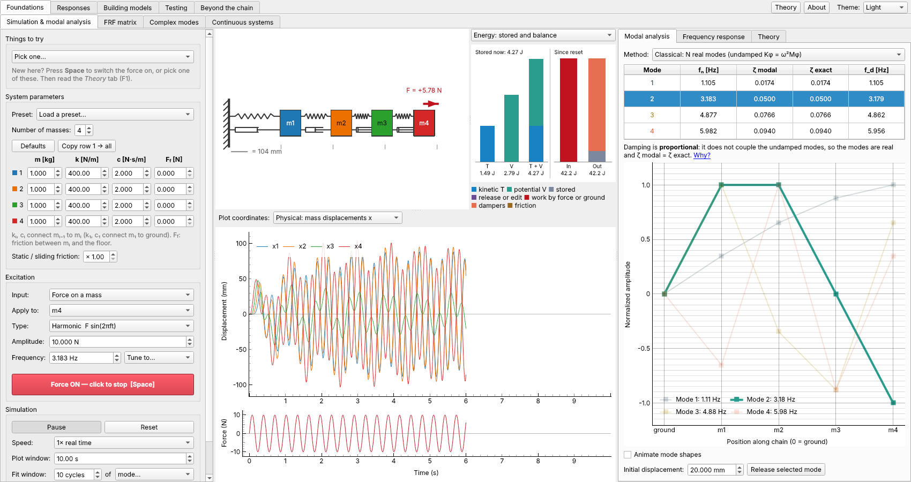

## Quick start

Standalone builds for Windows, macOS (Apple Silicon) and Linux, which need no Python
install, are on the [Releases](https://github.com/WookieLumberjack/vib_tutorial/releases)
page. They aren't code-signed; the release notes say how to open them past the system's
warning.

To run from source instead, you need [uv](https://docs.astral.sh/uv/) and a
[Rust toolchain](https://rustup.rs/) (uv builds the app's Rust kernels, in `native/`, on
the first sync).

```bash
uv sync               # create .venv and install dependencies
uv run vib-tutorial   # launch the app (or: uv run python -m vib_tutorial)
uv run pytest         # run the tests
```

## The window

| Area | What it holds |
|---|---|
| **Left** | System parameters (m, k, c for each element and friction F<sub>f</sub> for each mass, 1 to 8 masses), the excitation (a force on a mass, or motion of the ground), and simulation controls (run/pause, speed, plot window, auto-scale) |
| **Centre** | Animation of the chain (with a scale bar for the real displacement) and live energy bars, above time histories of the applied force and of the motion (in physical or modal coordinates), of the energy, or of the force in each spring and damper |
| **Right** | Tabs: *Modal analysis* (table, mode shapes, release), *Frequency response*, and *Background* (theory notes written for students) |

Seven more pages work on the same chain, in order from analysis to simplification to test:
**FRF matrix** shows every term of the receptance matrix and how the modes build it up,
**Modal coupling** joins two halves of the chain one mode each, to show when their modes split,
**Substructuring (CMS)** reduces the chain by component mode synthesis (Craig–Bampton, Rubin or
MacNeal), **Virtual modal test** measures the FRF from simulated force and response signals,
as in a lab, **Operational modal analysis** finds the modes from the responses to unmeasured
ambient forces alone, **Random vibration** shakes it with a random force or base and
predicts the response's spectrum and RMS, and **Complex modes** shows when its damping makes the
modes complex and what the usual approximation then misses. The **Jeffcott rotor** page leaves the chain for a
spinning shaft: a disc on a flexible shaft in flexible bearings, and the **Duffing & Mathieu**
page for a single mass on a nonlinear spring, driven through its jump or pumped into parametric
resonance. The **Torsional vibration** page twists a drive train of discs, shafts and gear meshes,
and starts it with a motor, and the **Continuous systems** page refines the chain into a string, a
bar or a beam to show which of its modes to trust (all below).

### Themes

*Theme* (top right) switches the whole app between **Light**, **Dark**, **Solarized** and
**Nord**, live, without resetting the simulation. **System** (the default) follows the
desktop's light or dark setting, and changes with it. Each theme has its own palettes for
the masses, modes and substructures, chosen so every curve, label and table entry stays
legible on its background. The choice is remembered.

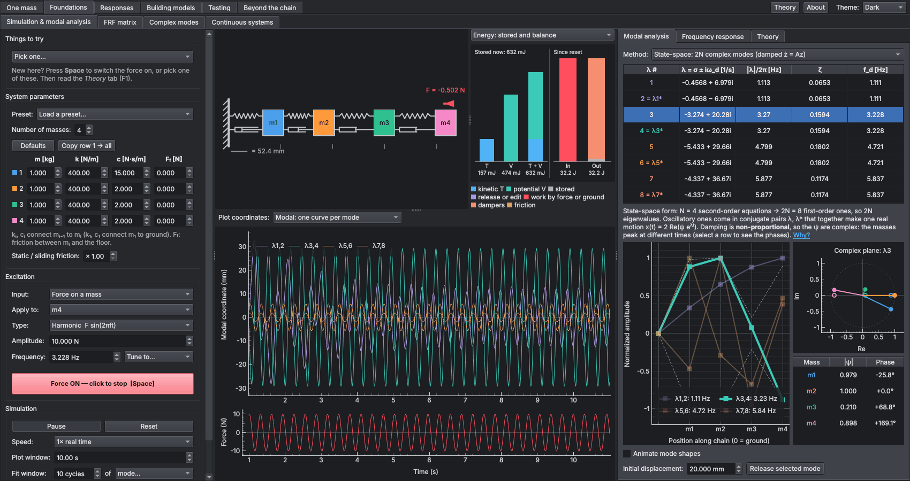

## What you can do

- **Edit any mass, stiffness, or damping value while the simulation runs.** The state is
  kept, so you see the system respond to the change.
- **Give a mass friction** (*System parameters → F<sub>f</sub>*): Coulomb friction against the
  floor, the force μN opposing the sliding. This makes the chain nonlinear. Released from
  rest, a single mass still swings at its undamped natural frequency, but loses a fixed
  4F<sub>f</sub>/k of amplitude per cycle (a straight-line decay, not an exponential one) and
  sticks for good at the first turn within F<sub>s</sub>/k of rest, F<sub>s</sub> being the
  static friction. *Static / sliding friction* (one ratio for the whole floor) sets
  F<sub>s</sub> above F<sub>f</sub>: a stuck mass then holds until its springs pull harder
  than F<sub>s</sub>, and lurches off against the smaller F<sub>f</sub>, which gives
  stick-slip under a slow pull. The simulation includes friction exactly. The modes and
  frequency responses use the linear chain, with two approximations of friction beside them:
  the modal table's *ζ friction* column (each mode's equivalent viscous damping at the
  release amplitude, c<sub>eq</sub> = 4F<sub>f</sub>/πωX, so it falls as the amplitude
  grows), and on the *Frequency response* tab a dash-dot describing-function response at the
  excitation's amplitude, where a mass that friction holds still leaves a gap.
- **Apply a force to any mass**: a step, a harmonic `F sin(2πft)`, a rectangular pulse, or a
  chirp (a frequency sweep). Press **Space** (or the button) to switch it on and off, and
  watch the transients as it starts and stops.
- **Shake the ground instead** (base excitation): the wall moves with the same waveforms,
  and the *Frequency response* tab shows the transmissibility (below).
- **Pluck a mass**: drag any mass sideways with the mouse and let go (below).
- **Tune the drive frequency to a natural frequency** from the "Tune to…" menu to see
  resonance build up.
- **Release a mode**: select a mode in the table and click *Release selected mode*. The
  masses start from that mode shape and vibrate freely. The plot window can be fitted to
  a number of cycles of any mode.
- **Switch between two modal-analysis methods** (below), and compare them on the same
  system.
- **Plot the motion in modal coordinates** (*Plot coordinates → Modal*, above the time
  histories): one curve per mode instead of one per mass (below).
- **Watch the energy** in the bars beside the animation: kinetic and potential, an exact
  balance of energy in (release, force) against energy out (stored, dissipated), and each
  mode's share. *Plot coordinates → Energy* draws the same quantities against time (below).
- **Plot the force in every spring and damper** (*Plot coordinates → Element forces*):
  the springs, the dampers, or both together (below).
- **Load a preset** (*System parameters → Preset*): the plain chain, an undamped
  vibration absorber, a tuned mass damper with Den Hartog's tuning, or a damper on the roof
  of a 4-storey building shaken by the ground, each with the excitation that shows it off
  (below).
- **Slow motion** (0.05× to 2×) for the higher modes, and auto-scaled animation and plots
  so small motions stay visible.

### Plucking a mass

Drag any mass in the animation sideways and let go. While you hold it, the force is
switched off and time stands still. The other masses take the static shape a slow pull
gives, with every spring balanced, and a red arrow shows the force your hand needs. Let go
and the chain vibrates freely from that shape. The static shape is close to the first
mode, so most of the energy starts in mode 1 (see *Energy: by mode*). Pull on m1 instead and
more of it goes into the higher modes.

With friction the other masses stay where they are until their springs pull harder than the
static friction, and then slide only until the pull has fallen to the sliding friction. The
shape depends on the path: drag a mass out and back and the others stay out, held by
friction, and when you let go nothing may move.

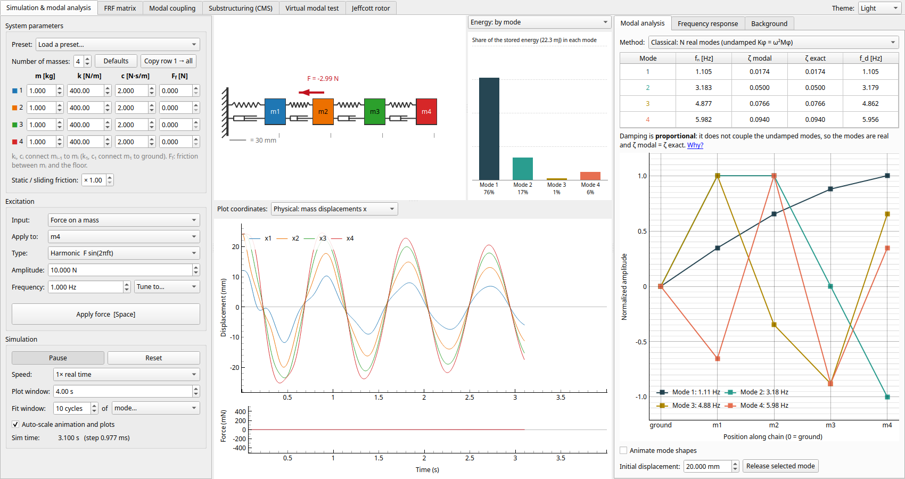

### Chirp and ground motion

*Type → Chirp* sweeps the drive frequency from a start to an end frequency over the sweep
time (linear, or logarithmic for equal time per octave), then stops. Each mode swells in
turn as the sweep passes it, and the dashed drive line on the *Frequency response* tab
follows the frequency. Below, a 40 s sweep from 2 to 7 Hz at m4 is plotted in modal
coordinates: mode 1 rings from the switch-on and decays, then modes 2, 3 and 4 swell
one after the other. Sweep faster and the peaks come later and lower.

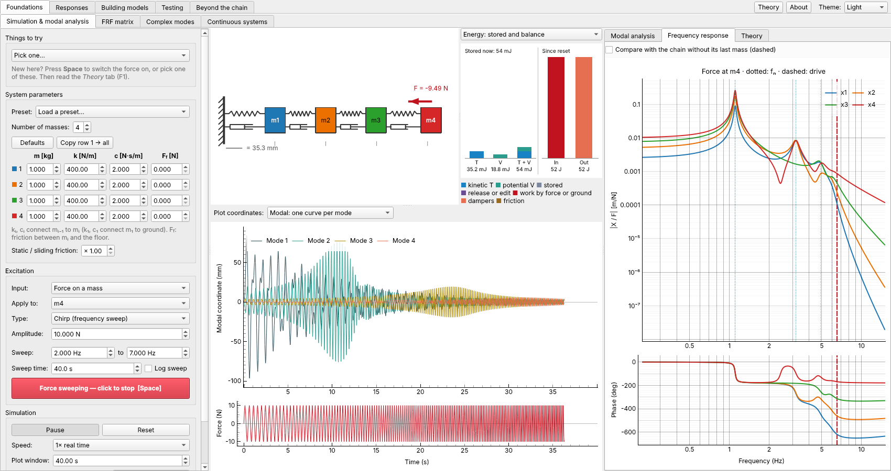

*Input → Ground motion (base)* moves the wall instead of pushing a mass, with the same
waveforms and an amplitude in mm. The ground reaches the chain only through k<sub>1</sub>
and c<sub>1</sub>, as the force k<sub>1</sub>x<sub>g</sub> + c<sub>1</sub>ẋ<sub>g</sub> on m1.
The plots show absolute displacements, the lower plot shows x<sub>g</sub>, and the
*Frequency response* tab shows the transmissibility |X<sub>i</sub>/X<sub>g</sub>|. It is 1
at low frequency, where the chain moves with the ground, and falls away above the modes
(for a single mass, below 1 only above √2 f<sub>n</sub>, whatever the damping).
The energy balance counts the work the moving ground does. Element forces, modal
coordinates and energy by mode use the motion relative to the ground.

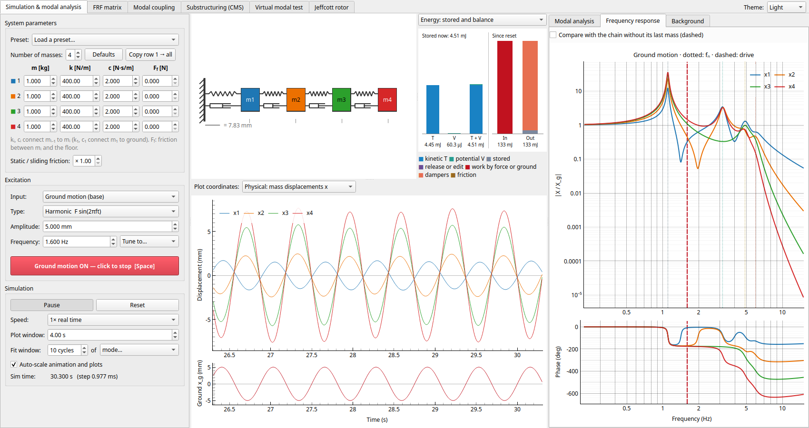

### Vibration absorbers and tuned mass dampers

*System parameters → Preset* loads a chain with one small mass hung on the end of it, tuned
to a mode of the chain it is attached to, and sets up the excitation. The *Frequency
response* tab then also shows the chain without it, thin and dashed (*Compare with the
chain without its last mass*).

- **Vibration absorber (undamped)**: a 0.1 kg absorber on a 1 kg, 3.18 Hz machine, tuned
  to 3.18 Hz with no damper. Driven there, the machine stands still: the absorber's
  spring pushes back with exactly the applied force. The one resonance becomes two, one
  either side.
- **Tuned mass damper (Den Hartog)**: a 5% damper tuned to f<sub>a</sub>/f<sub>1</sub> =
  1/(1 + μ) with ζ<sub>a</sub> = √(3μ/8(1 + μ)³) (relative to f<sub>1</sub>, as Den Hartog defined it). The resonance at 40 times the static
  deflection becomes two flat peaks under 6. Set c2 to 0 or to 5 to see why the damping
  has an optimum.
- **TMD on a 4-storey building**: the default chain shaken by the ground at its first
  mode, with a damper on the roof sized from mode 1's *modal mass* there
  (1/φ<sub>roof</sub>², φ mass-normalized).

Edit the absorber's k and c to see what mistuning does. The *Background* tab derives the
antiresonance, the fixed points and Den Hartog's tuning.

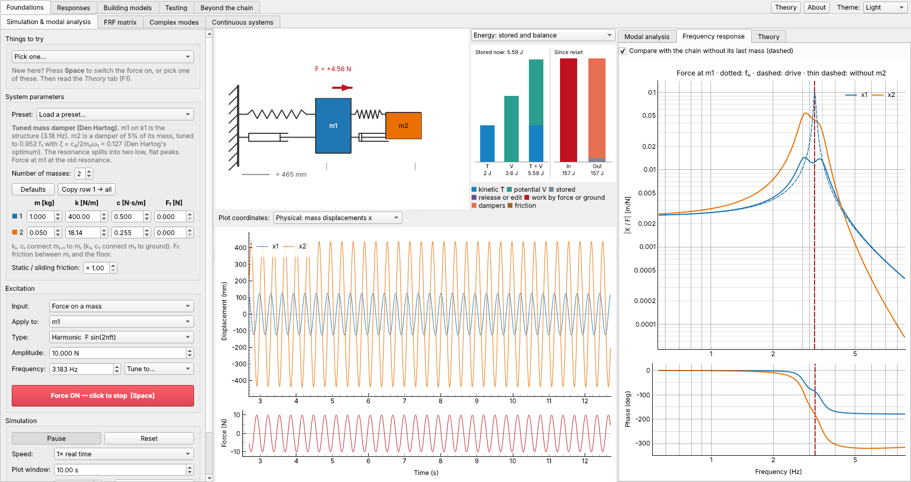

### Two modal-analysis methods

The *Method* selector on the Modal analysis tab switches between two ways of solving for
the modes.

**Classical: N real modes.** The undamped eigenproblem gives N natural frequencies and
real mode shapes; damping is estimated per mode. The table compares this estimate
(ζ modal) with the exact value (ζ exact). The note under the table says whether the
damping is *proportional*. If it is not, the estimate is only an approximation, and
releasing a real mode shape excites other modes too. Below, with only `c1` raised to 15,
the release of mode 3 leaves slow mode-1 motion behind:

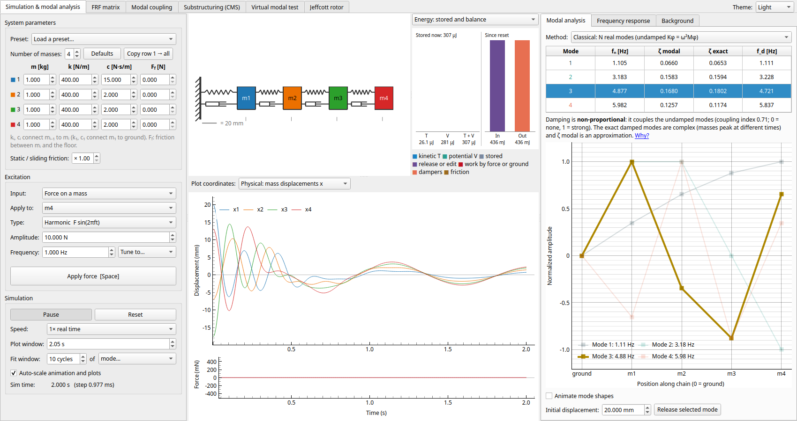

**State-space: 2N complex modes.** The full damped problem is solved in first-order form,
which gives all 2N eigenvalues: complex-conjugate pairs λ, λ* for oscillatory modes (and
real eigenvalues for overdamped or rigid-body motion). Selecting a row shows its complex
mode shape in a complex-plane (phasor) plot, with the amplitude and phase of each mass.
Phases other than 0° or 180° mean the masses peak at different times. Releasing a
complex mode sets both displacement and velocity, so on the same system only that mode
responds and decays cleanly:

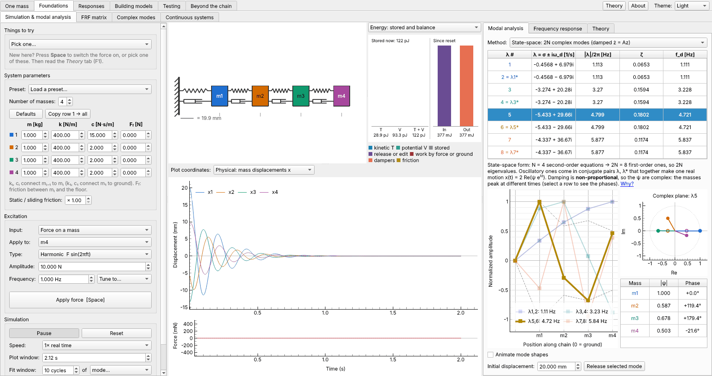

### Modal coordinates

*Plot coordinates → Modal* splits the motion into one curve per mode. Each curve is that
mode's share of the displacement of the mass it moves most, so its size compares
directly with the physical plot. The curves follow the *Method* selector:

- **Classical**: q = Φ<sup>T</sup>Mx with the real mode shapes, so x = Σ φ<sub>r</sub>q<sub>r</sub>
  exactly. With non-proportional damping these coordinates are coupled. Release mode 3 with
  `c1` = 15 and modes 1 and 2 pick up motion.
- **State-space**: η = V<sup>−1</sup>z with the complex eigenvectors, one curve 2 Re(η) per
  conjugate pair. These decouple for any damping. A released complex mode moves only its
  own curve.

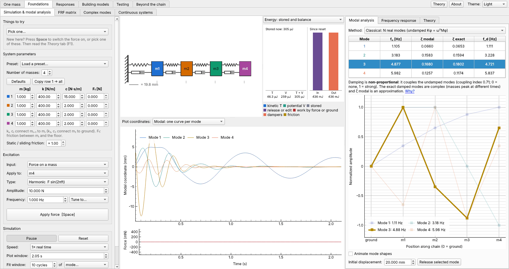

### Energy

The panel beside the animation has two views:

- **Stored and balance**: kinetic energy T, potential energy V and their sum, then a ledger
  since the last reset. *In* is the energy given by a release or a parameter edit plus the
  work done by the force. *Out* is the energy stored now plus the energy dissipated by the
  dampers and by friction. The simulator integrates the work and the dissipation exactly, so
  the columns always match.
- **By mode**: each undamped mode's share of the stored energy,
  ½(q̇<sub>r</sub>² + ω<sub>r</sub>²q<sub>r</sub>²). The shares always add up to T + V. With
  non-proportional damping the dampers move energy between modes. Release mode 3 with
  `c1` = 15 and within a second most of the energy left is in mode 1.

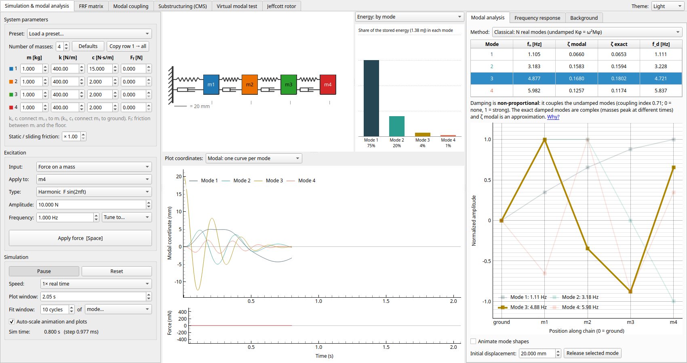

*Plot coordinates → Energy* draws the ledger as time histories: T, V and T + V, the energy
given by releases and edits E<sub>0</sub>, the work done by the force W, and the energy
dissipated by the dampers D and by friction D<sub>f</sub>. At every sample
E<sub>0</sub> + W = T + V + D + D<sub>f</sub>. Release a mode and T and V
swap twice per cycle while T + V decays and D rises towards E<sub>0</sub>. Drive the
chain just below a natural frequency and the stored energy beats. W falls whenever the
force pushes against the motion, and D keeps rising.

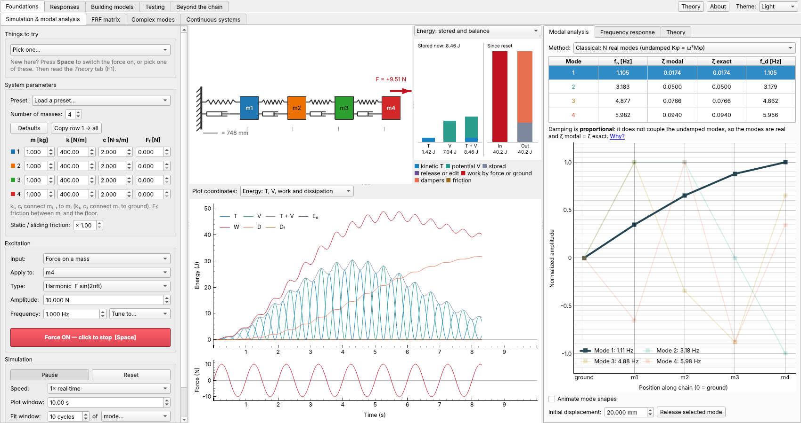

### Element forces

*Plot coordinates → Element forces* plots the tension in each element, in the colour of
its row under *System parameters*. Element i joins mass i−1 to mass i, and element 1 joins
mass 1 to the ground. A second menu picks what to plot:

- **Springs**: k<sub>i</sub>(x<sub>i</sub> − x<sub>i−1</sub>)
- **Dampers**: c<sub>i</sub>(ẋ<sub>i</sub> − ẋ<sub>i−1</sub>)
- **Spring + damper**: the total force the element carries. For element 1 this is the
  force on the ground.

Positive is tension. Apply a step force at the last mass and every spring rings about the
same static force, overshooting to about twice it. Once the motion dies away every spring
carries exactly the applied force and the dampers carry none. At resonance the elements
carry several times the applied force, and the damper force leads the spring force by a
quarter cycle.

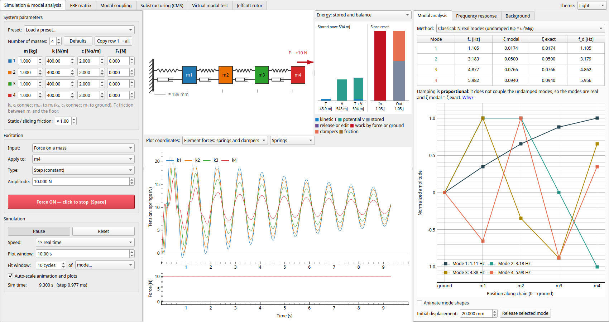

### Frequency response

The receptance |X_i / F| and phase of every mass for a force at the selected mass. The
natural frequencies are dotted and the current drive frequency is dashed.

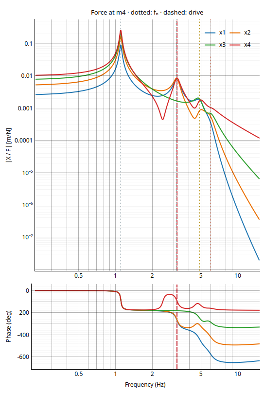

### FRF matrix

The *Frequency response* tab shows one column of the receptance matrix. The **FRF matrix**
page shows all N × N terms H<sub>jk</sub> = x<sub>j</sub>/F<sub>k</sub> as a grid of small
plots (row: response, column: force), on shared axes so their sizes compare directly.

- **Show** magnitude, phase (unwrapped), real part or imaginary part. The large plot on the right
  shows the selected term as magnitude with phase, or real with imaginary part.
- **Modes included in the sum**: each term is a sum of one term per mode. Untick modes to see
  the truncated modal sum (dashed red) against the full solution (black), and each mode's term
  in its own colour. The real part shows best how the terms add. The large plot shades the
  frequency band where the sum differs most from the full solution, and lists the **static
  compliance** (ω = 0): the ticked modes' sum against K⁻¹, and each mode's share of it.
- **Exact or classical terms**: the exact expansion uses the complex (state-space) modes and
  always sums to the full solution. The classical one uses the real modes with ζ modal, and
  misses even with every mode when damping is non-proportional.
- **Several forces at once**: Ctrl+click more plots in a row, or tick more forces, to see
  x<sub>j</sub> = Σ<sub>k</sub> H<sub>jk</sub>F<sub>k</sub> built from its terms.
- **Theory**: reciprocity, modal constants, why antiresonances appear (and how many), and
  truncation.

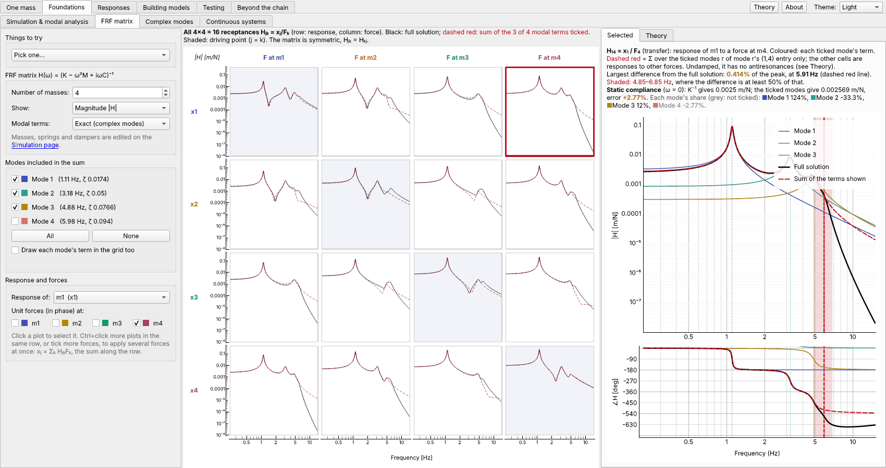

### Modal coupling

Two systems that are each fine on their own can misbehave once joined: when a mode of one is
close in frequency to a mode of the other, and the masses are not too different, the two
modes **split**. This is how a vibration absorber works, but it usually happens when nobody
meant it to. The **Modal coupling** page shows it on the chain. *Split after* cuts the chain into
**A** (the masses up to the cut, on the ground as before) and **B** (the rest, with the spring
and damper that joined it to A tied to the ground instead). Each is solved on its own, one mode of
each is replaced by a single-DOF oscillator that keeps its frequency and modal damping ratio, and
the two oscillators are joined again, B's on A's:

```
ground ──[k_a,c_a]── m_a ──[k_b,c_b]── m_b
```

The oscillator masses are the masses the joint feels:

- **B**: its **effective mass** along x, Γ² with Γ = φ<sup>T</sup>M**1** (φ mass-normalized),
  since B is joined at its base. The rest of B's mass (its other modes) moves rigidly with the
  base, so it is added to m<sub>a</sub> as B's **residual mass**.
- **A**: its **modal mass at the interface**, 1/φ<sub>tip</sub>², since A is joined at its tip.
  A's effective mass can be chosen instead, to see how much worse it does.

With these choices the 2-DOF model is a Rayleigh–Ritz model of the chain (B's part is
Craig–Bampton with one mode kept; see the next section), so its two frequencies are upper bounds of the chain's lowest
two. The page compares them with the chain's (frequency, exact damping ratio, MAC) and draws the
2-DOF modes on the chain. Any mode of A can be coupled with any mode of B. The *Drive-point FRF*
tab compares the receptance of the chain and of the 2-DOF model at the interface (A's tip) or at
the free end (B's tip, where a force is usually applied), with A alone (B removed) and B alone
(A removed, its base on the ground) for reference. *Matrices (step by step)* works both masses through with the current
numbers: the generalized mass and mass normalization (why 1/φ<sub>tip</sub>² is a mass), the
influence vector **r** solved from a unit base motion, each mode projected on how the joint loads it
(a point load **e**<sub>tip</sub> on A, the inertia M**r** on B), the 2-DOF matrices, and the
Rayleigh–Ritz check, with a notation table.

The **Veering & splitting** tab sweeps B's frequency (or the mass ratio μ = m<sub>b</sub>/m<sub>a</sub>)
and plots the chain's and the 2-DOF model's frequencies. Near f<sub>B</sub> = f<sub>A</sub> the two
modes veer apart instead of crossing; two oscillators tuned exactly end up √μ·f<sub>a</sub> apart,
whatever μ.

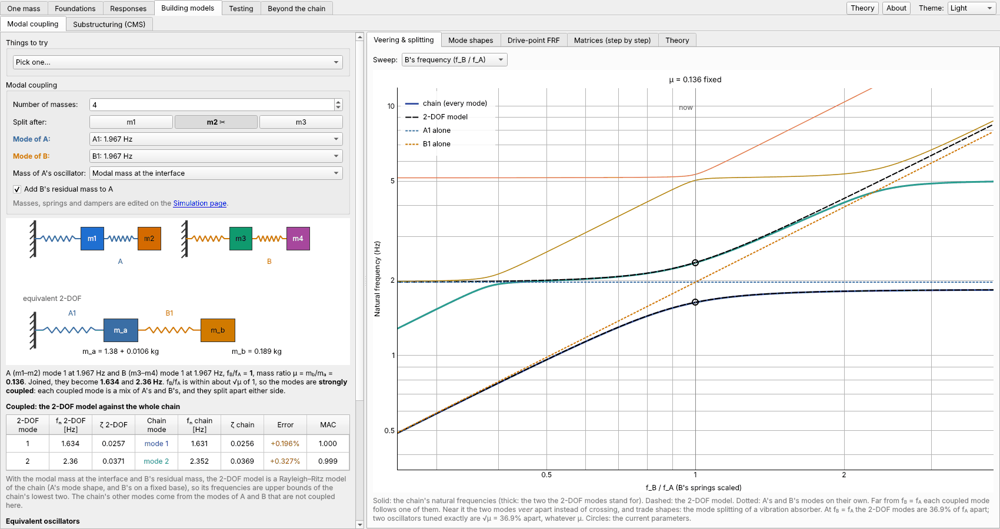

### Substructuring (component mode synthesis)

The *Substructuring* page starts with the whole chain as one substructure, whose only
boundary DOF is the tip: the single-component case, to learn the fundamentals on (Guyan then
reduces it to that one DOF, the largest error the page can show). Click masses under
*Interfaces at* to cut the chain there into substructures A (grounded), B, C, ... up to the
free end, and click them again to remove the cuts. The boundary (master) DOFs are the interfaces and the last mass, which is where
the force is applied, so the loaded DOF stays physical. Each substructure keeps its own
chosen number of modes plus one static shape per boundary DOF, and the reduced
substructures are assembled on the shared interface DOFs. The
*Method* selector chooses the component modes:

- **Craig–Bampton** (fixed interface): modes with the boundary held, plus constraint modes.
- **Rubin** (free interface): modes with the boundary free, as a modal test would measure
  them, plus the *residual flexibility* of the discarded modes. B floats on its own, so its
  rigid-body mode is always kept.
- **MacNeal** (free interface): as Rubin, but the residual flexibility is massless, so the
  boundary DOFs carry no inertia and the model has only as many modes as modes kept.

Everything on the page follows the selector:

- **Comparison table**: true vs reduced natural frequencies, the error (never negative for
  Craig–Bampton and Rubin, whose frequencies are upper bounds), and the MAC of the recovered
  shape.
- **Substructures on their own**: each substructure's own modes (natural frequency and
  exact damping ratio with its boundary held, or free), whether each is kept, and the
  coupled mode it becomes (largest share of that mode's energy).
- **Component shape overlay**: click a row of that table to draw the clamped component
  shape over the coupled mode it becomes.
- **Basis (T)**: every column of T drawn as a shape along the chain, the set of shapes every
  reduced-model motion is built from.
- **Modes & FRF**: the selected mode shape, true vs reduced, and the tip and interface
  receptance of both models for the force at the tip.
- **Time response**: the reduced model simulated beside the full one, with the same exact
  stepper and the same force at the tip (a step, a harmonic, or a pulse). The two chains are
  animated one above the other at the same scale, over time histories of the tip and interface
  and of their difference. All three methods are exact statically, so the error is in the
  vibration: small after a step, large when driven at a mode the reduced model has shifted
  (below). *Tune to…* offers the true and the reduced natural frequencies.
- **Back expansion**: the coupled (reduced) model solves only for [q, x<sub>b</sub>]; this tab
  recovers the interior masses from them afterwards, as a system analyst does with a
  substructure delivered as reduced matrices. Three recoveries of one interior mass and one
  spring force are compared with the truth: from the coupled solution with the reduced
  model's own T (split into the part the boundary drags along and the part the kept modes
  add), from the boundary motion alone (static), and *enhanced*, by re-solving the
  substructure's interior with the coupled model's boundary motion imposed. The lower chain
  draws the recovered masses hollow.
- **Compare methods**: the same cut reduced by all three methods, with the frequency error of
  every mode, and how the selected mode's error falls as modes are added, one at a time.
- **Matrices (step by step)**: every stage with the current numbers: the full K and M,
  each substructure's partitioned matrices, its component modes (kept and discarded), the
  constraint modes Ψ or the residual flexibility G<sub>d</sub>, the transformation T, the
  reduced matrices, the assembled reduced model, and each substructure's recovery (OTM) and
  loads (LTM) transformation matrices.
- **Theory**: what a basis is (with a 2-mass worked example) and why Craig–Bampton chooses
  its shapes, original vs substructured formulation side by side, Hurty vs Craig–Bampton,
  Guyan reduction as the zero-mode case, why free-interface modes need residual flexibility,
  MacNeal vs Rubin, the three methods side by side, back expansion (data recovery), a "Try it"
  walkthrough, and a notation
  table.
- **Presets**: *Guyan (0 modes)* (*Fewest modes* for the free-interface methods) and *All
  modes*.

With more cuts each substructure is smaller and has fewer modes to keep, but every interface
stays in the model as a physical DOF. For 8 masses and a 6-DOF model, one cut with 2 modes
each gets modes 1 to 4 within 0.7%; two cuts with 1 mode each only within 2.3%:

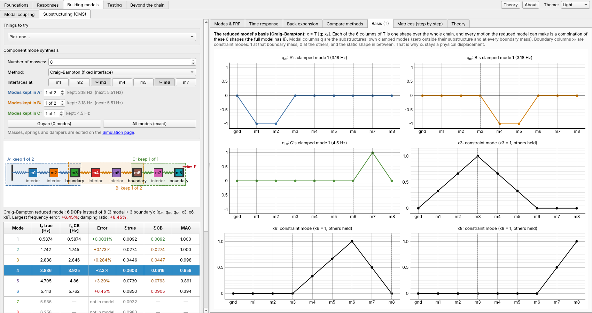

For each substructure, partitioned into interior $i$ and boundary $b$ DOFs,

$$\begin{bmatrix}x_i\\ x_b\end{bmatrix} = \underbrace{\begin{bmatrix}\Phi_k & \Psi\\ 0 & I\end{bmatrix}}_{T}\begin{bmatrix}q\\ x_b\end{bmatrix},
\qquad \Psi = -K_{ii}^{-1}K_{ib},\qquad \hat M = T^TMT,\ \hat K = T^TKT$$

where $\Phi_k$ are the $k$ lowest mass-normalized modes of $K_{ii}\phi = \omega^2 M_{ii}\phi$.
$\hat K$ is block diagonal, $\mathrm{diag}(\omega_k^2)$ and $K_{bb} - K_{bi}K_{ii}^{-1}K_{ib}$, while
$\hat M$ couples $q$ to $x_b$.

The free-interface methods use the lowest $k$ modes $\Phi_k$ of the whole substructure,
$K\phi = \omega^2 M\phi$, and keep the static response of the discarded ones through the
residual flexibility $G_d = \Phi_d\Lambda_d^{-1}\Phi_d^T$. Writing
$x = \Phi_k q + G_d E_b f_b$ and eliminating the interface forces $f_b$ with the boundary
rows gives a transformation of the same shape as Craig–Bampton's:

$$T = \begin{bmatrix}\Phi_{ik} - R\,\Phi_{bk} & R\\ 0 & I\end{bmatrix},\qquad R = G_{ib}G_{bb}^{-1}$$

Rubin's method projects with it, $\hat M = T^TMT$; MacNeal's drops the residual mass,
$\hat M = \mathrm{diag}(I, 0)$. Both have $\hat K = T^TKT$, which now couples $q$ to $x_b$.

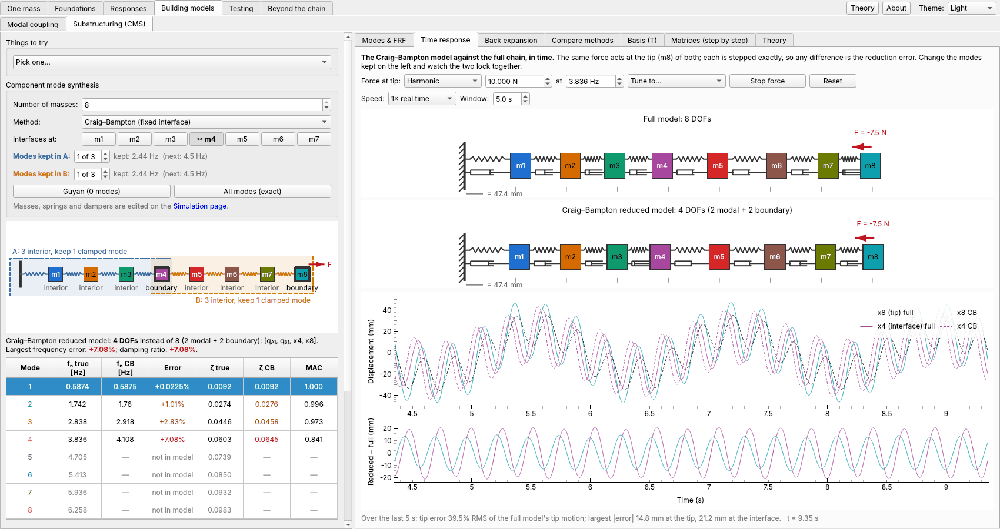

After the coupled solve each substructure recovers its interior from its own rows of T,
$x_i = \Psi x_b + \Phi_k q$ (Craig–Bampton). The *enhanced* recovery instead solves
$M_{ii}\ddot x_i + C_{ii}\dot x_i + K_{ii}x_i = -K_{ib}x_b - C_{ib}\dot x_b$ with the coupled
model's $x_b(t)$, so it keeps every interior mode and its only error is the error in $x_b$:

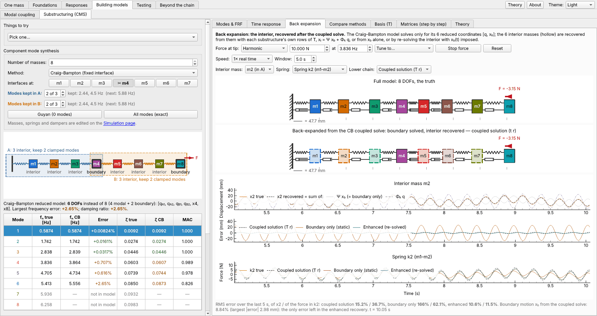

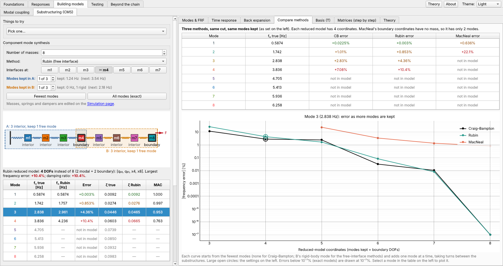

### Virtual modal test

The **Virtual modal test** page measures the FRF the way a lab does: from sampled force and
response signals alone, never from M, C and K. A force excites one mass, every mass's
displacement or acceleration is recorded, and the FRF column (receptance or accelerance) is
estimated and drawn over the exact one.
Each step of the measurement, and each error it can bring in, can be switched on and off.

- **Excitation**: impact hammer (the tip sets the pulse length, and so how high it
  excites), continuous random, burst random, periodic random, periodic chirp, or stepped
  sine. The response is simulated with the same exact first-order-hold discretization as
  the simulator. **Force level** scales the force.
- **Response sensor**: displacement (receptance) or acceleration (accelerance, as with
  accelerometers). The acceleration comes from the simulated chain itself, so it is filtered,
  sampled and made noisy like a real accelerometer signal. With response noise, displacement
  loses the high modes and acceleration the band below the first mode; modes are extracted
  after dividing by −ω².
- **Acquisition**: sample rate (automatic, or set by hand), block size (which sets
  Δf = f<sub>s</sub>/N<sub>b</sub>), averages, overlap, and an anti-alias filter. Turn the filter
  off and a mode above Nyquist folds back into the band.
- **Noise** on the force and on the responses, as a percentage of each channel's peak.
- **Processing**: rectangular, Hann, flat-top, or force + exponential windows, and the H1 or
  H2 estimator, with coherence. With the exponential window, a dashed curve shows the exact
  FRF with the damping the window adds.
- Noise and processing act on the data already measured, so the same test can be compared
  with different windows, estimators or noise levels. Blocks are measured a few per frame,
  so the average can be watched settling.
- **Friction and the linearity check**: give the masses friction (F<sub>f</sub> on the
  Simulation page) and the response is simulated with stick-slip, step by step. The chain is
  then nonlinear, so the measured FRF depends on the force level and the excitation: a light
  force gives low, heavily damped peaks, a strong one approaches the frictionless FRF, and the
  coherence drops even without noise. *Hold for comparison* keeps one FRF on the plot while you
  measure at another level, the overlay a lab uses to check linearity. A stepped sine reads
  the first harmonic at each frequency, so with friction it is drawn against the
  describing-function FRF at its force level. With 0.5 N on each mass of the default chain,
  the measured |H| is within 0.7% of it (median) at 10 N and 1.6% at 3 N, where the
  frictionless FRF is 5% and 18% off.
- **Setup check**: each mode's half-power bandwidth against Δf, how much of a hit is left
  at the end of the block, the hammer's level at each mode, and aliasing.
- **Theory**: sampling and aliasing, the DFT and leakage, windows, averaging, H1 against H2,
  coherence, the excitation types, and what friction does to a measured FRF.

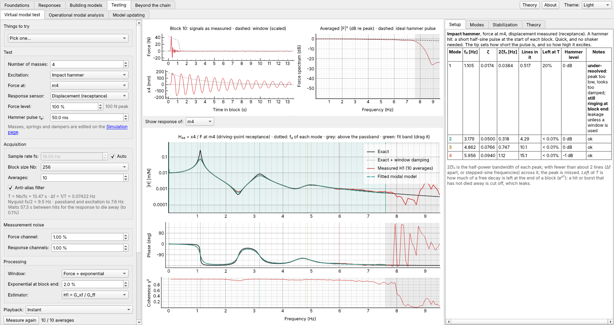

**Modal parameters** are then extracted from the measured FRF column and compared with the
exact modes:

- **Peak picking**: a mode at each peak, damping from the half-power bandwidth, the shape from
  the FRF at the peak. It shows the limits of the line spacing.
- **Circle fit**: ω<sub>n</sub> and ζ from the angles on each mode's mobility circle, between
  the frequency lines.
- **LSCF + LSFD**: a common-denominator fit of every response at every model order, shown as a
  **stabilization diagram**. The stable columns are picked automatically, and you can click
  poles to add or remove them. Residues and residual terms then come from a least-squares fit.
- A **fit band**, dragged on the FRF plot, sets which lines are fitted. The fitted modal model
  is drawn over the measurement.
- The **Modal parameters** tab lists f<sub>n</sub>, ζ and MAC against the exact modes (missed
  and extra modes included), with a MAC matrix. The exponential window's damping can be
  removed from the identified poles.

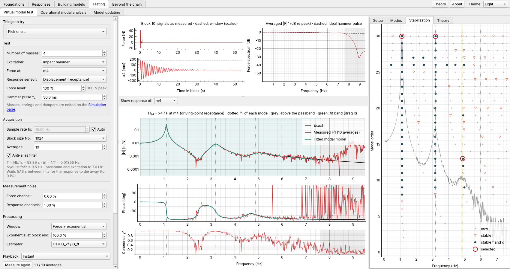

### Operational modal analysis

A bridge or a running machine can't be hammered: it is shaken by traffic, wind or its own
working, forces nobody measures. The **Operational modal analysis** page drives the chain with
random forces at every mass (or at one), records every mass's response only, and finds the modes
from those responses.

- **The record**: independent Gaussian forces, white or low-passed, through the same exact
  update as the rest of the app, after the start-up transient has died away; then the anti-alias
  filter, sampling, and sensor noise sized to each channel's RMS. The record length, sample rate
  and block length are set from the chain's modes (two thousand periods of the slowest).
- **Frequency domain decomposition (FDD)**: the responses' cross-spectral matrix by Welch's
  method, and its singular values at each line. The first peaks at every mode, its singular
  vector there the shape. Peaks are picked automatically; click to add or drop one.
- **Enhanced FDD**: the lines round each peak whose singular vector still matches make the mode's
  bell, and its inverse transform, the mode's autocorrelation, gives the damped frequency from
  its zero crossings and the damping from its decay (*EFDD* tab).
- **Stochastic subspace identification (SSI-cov)**: a state-space model fitted to the responses'
  correlations at every model order, the stable poles picked automatically from a stabilization
  diagram (or by clicking). It fits every mode at once, so close, heavily damped modes come out
  far better than from EFDD's bells.
- **A machine running**: an optional sine force on m1, a sharp peak with almost no damping that
  looks like a lightly damped mode. Peaks whose response, projected on their shape and filtered
  round them, has a kurtosis near a sine's 1.5 (a mode's is 3) and no damping are crossed out as
  harmonics.
- **Against the exact modes**: f<sub>n</sub>, ζ and MAC, as on the virtual modal test, with the
  shapes unscaled (no force, no modal mass). The *Methods* tab sets FDD + EFDD, SSI-cov and a
  hammer test (the virtual modal test's way, on m1) side by side.
- **Things to try**: a short record, short blocks (leakage: too much damping), forces at a node
  of a mode (it is missed), coloured forces, noisy sensors, SSI on the close damped modes, and a
  machine running between two modes or right by one.

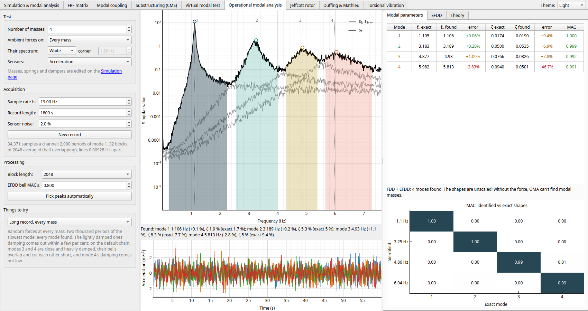

The default chain's two lower modes come out within a fraction of a per cent in frequency and a
tenth in damping. Modes 3 and 4 are close and heavily damped (7.7 and 9.4 %):
their bells overlap and cut each other short, and EFDD's damping for them is poor. SSI-cov
gets them within about 15 %; the hammer test, knowing the force, does better on the modes it
finds.

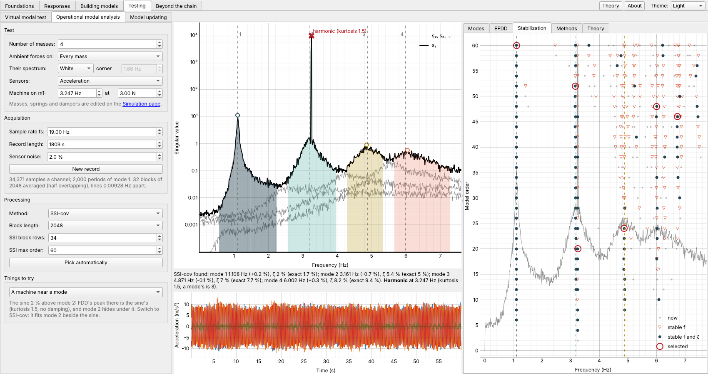

With a machine running just above mode 2, FDD's peak there is the sine's, and mode 2 is lost
under it; SSI-cov fits mode 2 beside the sine, which the kurtosis test crosses out.

### Random vibration

The **Random vibration** page drives the chain with a stationary random input given by its power
spectral density, flat over a band: a force on one mass or on every mass (N²/Hz), or the base's
acceleration, as on a shaker table (g²/Hz). It follows the chain on the Simulation page, without its
friction.

- **The response's PSD**: exact, G<sub>y</sub> = H G<sub>u</sub> H<sup>H</sup>, for a mass's
  displacement (relative to the base), its acceleration (absolute, in g) or a spring's force, with
  the record's Welch estimate on top.
- **The RMS**: the cumulative RMS √∫G df climbs a step at each mode, showing each one's share; its
  end is the RMS, against the record's standard deviation and its expected scatter.
- **Miles' equation**: each mode as a single oscillator under white input at its frequency, its RMS
  √((π/2) f<sub>n</sub> Q G) through the mode shape, and the modes combined by SRSS, in a table beside
  the exact RMS. It misses what isn't resonant, such as a forced mass's acceleration above the modes
  (the mass line).
- **The record**: the input synthesized to the PSD asked for, the chain stepped by the exact FOH
  update, sized from the narrowest peak (four Welch lines across its half-power width, sixteen blocks),
  with the block length and a new record at a click.
- **Statistics** (*Statistics* tab): the record's values against the Gaussian (the fraction beyond
  ±1, 2 and 3σ, skewness and kurtosis), and its peaks against Rice's distribution for the response's
  irregularity α = ν₀/ν<sub>p</sub>. Rice's rates from the PSD's spectral moments, ν₀ = √(m₂/m₀) upward
  zero crossings and ν<sub>p</sub> = √(m₄/m₂) peaks a second, sit beside the counts. Then the
  expected largest peak over a stretch, Davenport's (independent crossings) and Vanmarcke's (crossings
  clumped on a narrow band's envelope), against the record's stretches' largest values.
- **Things to try**: a base shake, a force on the last mass, forces on every mass, the base spring's
  force, a short record, coarse lines (the peak comes out low but the RMS keeps its area), and a
  narrow band on mode 2.


Shaken at 0.01 g²/Hz, 0.32 g RMS, the default chain's last mass sees 0.91 g RMS, 92 % of its mean
square from mode 1 (Q = 29). Miles' equation, mode by mode, is 0.2 % off; the simulated record's RMS
is within its ±2.6 % scatter.


The force in the spring that carries the chain off the base crosses zero 1.14 times a second, as Rice
says from its spectrum. Over a minute Davenport expects its largest peak at 3.11σ; but most of it is
mode 1, a narrow band whose peaks come in clumps, and Vanmarcke's 2.84σ is closer to the record's
2.79σ.

### Complex modes

The **Complex modes** page looks at what the damping does to the chain's modes. With proportional
damping (Φ<sup>T</sup>CΦ diagonal: here, a damper per spring in proportion to it) every mode keeps its
real, undamped shape; a damper on its own couples the modes, and the exact (state-space) shapes become
complex: each mass peaks at its own time, and the nodes move. It follows the chain on the Simulation page.

- **The mode in the complex plane**: one arrow per mass, with the best-fit line, and its snapshots over
  half a cycle: one shape, scaled, for a real mode; changing shape, the nodes wandering, for a complex one.
- **How complex**: every mode's MPC (modal phase collinearity: 1 real, 0 spread evenly), MPD (mean
  phase deviation from the best-fit line) and MAC with the undamped shape, and the phases' scatter
  (*Phases* tab).
- **The proportional approximation** (ζ = φ<sup>T</sup>Cφ/2ω, the off-diagonal terms dropped): its poles
  against the exact ones in the table, its FRF against the exact one (*FRF*), and a *Free decay* from an
  undamped mode's shape: exactly that mode with proportional damping, otherwise the damping hands some
  of the motion to the others.
- **Sweep**: one damper (or spring) swept over four decades, the rest of the chain as it is: each mode's
  exact pole (the root locus), its damping ratio exact and approximated, and its MPD. A damper's modes damp
  more as it grows, peak, and fall again as it locks its joint and the modes become the locked chain's,
  one pair leaving as overdamped roots; the approximation's ζ grows for ever.
- **Identification**: an FRF column with a little noise fitted by LSFD on the exact poles, with complex
  modes and with real (normal) modes: their shapes' MAC with the exact ψ and the undamped φ, the
  complex fit's MPC, and how far each fit's FRF misses.
- **Chains to try** (loaded into the Simulation page): proportional dampers, one damper at the base, one
  at the top, a strong damper that locks a joint (a mode overdamped), and a tuned mass damper's two close
  modes. *Make it proportional* sets c<sub>i</sub> = βk<sub>i</sub>, keeping mode 1's ζ.


With one damper at the base, mode 3 is the most complex: its masses' phases spread up to 54° from the
best-fit line. The approximation puts mode 4's damping at twice the exact value, and a release in
mode 3's undamped shape passes half of it to mode 2.


Swept, the same damper gives mode 1 at most ζ = 0.147, at 60 N·s/m; stiffer, it locks m1 to the base and
the modes become those of the three masses above it. Fitted with real modes, this chain's FRF misses by
29 %, and mode 3's shape has a MAC of 0.51 with the exact one; with complex modes it misses by 0.28 %,
the noise's share.

### Jeffcott rotor

The **Jeffcott rotor** page spins a disc on a flexible shaft, between two bearings
or overhung past one, each bearing on springs and dampers to ground, horizontally and vertically (or in an oil film,
or floating in an active magnetic bearing). The disc has a mass,
polar and diametral moments of inertia, and a mass unbalance; the disc can also be skewed on
the shaft, the shaft bent (bowed), made stiffer about one axis than the other (asymmetric), and cracked. With the Jeffcott model's massless shaft the model has 8 DOFs: in each
plane, both journals, the disc, and the shaft's slope at the disc. Give the shaft its mass and
it becomes a beam finite element model, reduced to those 8 DOFs plus a few of the shaft's own
modes. It is stepped in state space with the same exact first-order-hold update as the chain, as
the speed ramps to a target.

- **Presets**: the classic Jeffcott rotor, an off-centre disc, anisotropic supports, an
  overhung rotor, a long shaft whose own mass matters, a two-pole rotor with an asymmetric shaft,
  a cracked shaft, oil swirl at λ = ½, and plain journal bearings, both going into oil whip, an
  upright rotor in oil whirl, an overhung rotor on magnetic bearings that its controller's lag
  makes unstable, and three rotors rubbing a stator ring: a partial rub with ½X, a full rub that
  flips into backward whirl, and a light rub that bows the shaft (the Newkirk effect). Each loads a rotor with a speed range to suit it and a note on what to look for.
- **Shaft mass**: tick it (and set the density) and the shaft gets its mass, its sections'
  rotary inertia and their gyroscopic moment. It is then 2 to 60 Euler–Bernoulli beam elements
  with consistent or lumped mass, reduced Craig–Bampton style to the stations and the shaft's
  modes with the stations held, up to 1 kHz. The Campbell diagram draws the massless model's
  branches dashed beside the real ones.
- **3D view**: the whirling shaft, the disc with its heavy spot, and the supports, drawn
  in perspective on an ordinary 2D plot, with no OpenGL. Drag to turn it.
- **Orbits** at bearing A, the disc, midspan and bearing B, seen from the B end, with
  once-per-revolution (keyphasor) marks. A line on the disc's orbit points at the heavy spot,
  so the phase lag can be read off it: 0° below the critical speed, 90° at it, 180° above.
- **Speed**: a target and a ramp rate, for run-ups and coast-downs through the criticals.
  Tapping the disc rings every mode, forward and backward; it can also tap again and again as
  it runs, like an impact test at speed.
- **Run-up and coast-down**: one button ramps to a starting speed, lets the start-up transient
  die away, then runs up to a second speed and back at the ramp rate. Once per revolution a
  keyphasor-triggered DFT takes the 1X vector (a tracking filter), along with the largest
  displacement over the revolution. Each leg becomes its own trace; earlier sweeps can be held
  to compare ramp rates, and a table gives each one's peak and the speed it came at against
  the steady state.
- **Bode and polar plots**: the steady-state 1X (or 2X) amplitude and phase lag against speed at
  either bearing, the disc or midspan, read by an x or a y probe or as the orbit's major axis,
  with the tracked sweeps over it and a marker at the current speed. On the polar plot the
  steady-state vector traces a near-circle through each critical speed.
- **Bent shaft and skewed disc**: two more sources that turn with the shaft. The bow, a set
  bend δ<sub>b</sub> at the disc at an angle from the keyphasor mark, drives the rotor with a force
  kδ<sub>b</sub> that does not grow with speed: the probes read it at slow roll, the polar curve
  starts from it, and well above the critical the disc settles on the bearings' axis. Against
  the unbalance it adds or cancels, depending on its angle. The skew τ is a couple unbalance,
  a moment (I<sub>d</sub> − I<sub>p</sub>)τΩ² on the disc's tilt.
- **Gravity**: lay the rotor horizontal and it sags (378 µm at the disc with the defaults)
  and whirls about the sagged position, its orbits below the bearings' centre. *Static sag*
  switches the drawing between a DC-coupled probe's view and an AC-coupled one. The tracking,
  the spectrum and the phase always use the vibration about the sag, which is exactly the
  response without gravity: gravity alone makes no whirl, even on anisotropic supports (unless
  the shaft is asymmetric or cracked). Cross-coupled bearings and internal damping push the sag sideways.
- **Asymmetric shaft**: a shaft stiffer about one axis, EI(1 + Δ), than across it, EI(1 − Δ),
  as a two-pole generator's slots make it, its stiff axis at an angle from the keyphasor mark.
  Its stiffness turns with it, so it has two critical speeds and between them an unstable band
  where the whirl grows locked to 1X; laid horizontal, its weight drives a 2X whirl that peaks
  near half the critical speed (the gravity critical); and its 1X response depends on where the
  heavy spot sits from the stiff axis. The modes are exact Floquet modes (from axes turning with
  the shaft, or Hill's method on anisotropic supports), the steady states come by harmonic
  balance, and the time step splits off the turning stiffness as a mid-step kick.
- **Cracked shaft**: a transverse crack, its depth (up to half the shaft), its place along the
  shaft and its mouth's angle from the mark. Open, it is a hinge whose compliance comes from
  fracture mechanics (much larger to bending that opens it), condensed exactly onto the stations.
  Breathing, the shaft's weight opens and shuts it once a turn (weight dominance, as in Mayes and
  Davies' model), so its stiffness has 1X, 2X and 3X in it: the weight drives 2X and 3X whirls
  near a half and a third of the critical speed, and adds its own 1X to the unbalance's. The same
  machinery takes it, Hill's method and harmonic balance over every harmonic; the Bode and polar
  plots track 3X too.
- **Balancing, in one plane or two**: the field procedure by influence coefficients. Read the
  slow roll, the 1X vector as found, then with a trial weight, and the page works out the
  correction weight (grams at a radius and an angle from the keyphasor mark), puts it on and
  checks it. Each reading is a measurement on the running simulation: ramp, settle, average
  ten revolutions. *Mystery unbalance* hides the heavy spot to find. The response before and
  after against speed shows what one weight can and cannot do: subtract the slow roll and a
  bowed rotor is balanced at every speed, leaving only its runout; balance the raw reading and
  it is out of balance away from the balancing speed; a skewed disc's couple needs two planes.
  - **Two planes**: two probes, a trial run in each plane in turn, the 2 × 2 influence matrix
    with its condition number, and the two weights from its inverse. The planes are the disc's
    two faces (a set distance apart), which cancel its unbalance and couple at every speed, or
    anywhere on the shaft, which cancel the readings only at the balancing speed unless the
    planes are close to the unbalance. *Mystery unbalance* then hides a skew too.
- **Campbell diagram**: the damped natural frequencies against speed, coloured by whirl
  direction, with the 1X line and the critical speeds, and the onset of instability with the
  growing modes crossed. Drag the speed line to set the target. The speed range is adjustable
  (up to 60,000 rpm, and the speed controls and plots follow it), and 2X and ½X lines can be
  drawn too.
- **Overhung disc**: put the disc past a bearing (a/L above 1 or below 0) and it tilts as much as
  it moves, so the gyroscopic moment acts on the first mode in full and its forward and
  backward criticals separate strongly.
- **Stability**: cross-coupled bearing stiffness k<sub>xy</sub> = −k<sub>yx</sub>, constant or
  growing with speed as λcΩ (a fluid-film bearing's oil swirling at λ times the shaft's speed), or a
  journal bearing's film itself,
  and the shaft's internal (rotating) damping. The stability map draws each mode's damping ratio or
  log decrement against speed and marks the onset speed, where a forward mode's damping
  crosses zero (and, for an asymmetric shaft, where its unstable band ends). The asymmetry chart
  maps the instability against the shaft's asymmetry and the speed, an Ince–Strutt chart with one
  tongue between the two axes' critical speeds. Below it, the full spectrum of an orbit (the FFT of x + iy) separates forward
  from backward whirl, so past the onset the subsynchronous whirl shows as a growing line below
  +1X. The simulation pauses once the whirl reaches 2% of the span.
- **Waterfall and cascade**: full spectra of a station's orbit taken block by block as the rotor
  runs, stacked against the speed of the latest run-up or coast-down (a cascade) or against time
  (a waterfall), on a log or linear scale. The 1X line and the free whirl frequencies at each
  line's speed are marked under it. Tapped all through a run-up, the peaks trace the Campbell
  diagram's branches. The block length trades frequency resolution against the smear of 1X while
  the speed ramps.
- **Fluid-film bearing**: a plain journal bearing by short-bearing (Ocvirk) theory, from its
  diameter, length, clearance, oil viscosity and load: the Sommerfeld number, the journal's
  eccentricity and attitude angle, its locus in the clearance circle as the speed rises, and the
  eight linearized stiffness and damping coefficients against the speed or (dimensionless, as on a
  design chart) S(L<sub>b</sub>/D<sub>b</sub>)², the modified Sommerfeld number, on which a short bearing depends alone,
  read at the rotor's speed now. Their skew part is exactly the
  λ = ½ swirl of the bearing table, and Lund's formula gives the speed at which a rigid rotor on the
  bearing goes into oil whirl. Choose *Oil-film journal bearings* under the bearing supports and the rotor runs in it at both ends,
  each under its share of the weight: their stiffness and damping change with the speed, the journals
  rest on the locus and rise along it (with *Static sag*), and oil whip comes from the bearing's own
  cross-coupling. Tick *Nonlinear film* beside it and the time response takes the films' whole force,
  in closed form, stepped by Newton's method beside the exact update: the journals stay inside their
  clearance through the critical, oil whirl settles to a limit cycle at half the speed, and oil whip
  grows on, the films holding the journals but not the shaft. Linearized, the page pauses when a
  journal reaches its clearance.
- **Magnetic bearing**: an active magnetic bearing, a pair of electromagnets on each axis under PID
  control. From the air gap, bias current, pole area and turns come the magnets' negative stiffness,
  the current gain and the load capacity; from the gains, the derivative's filter and the amplifier's
  bandwidth, the bearing's equivalent stiffness and damping against frequency, shaded where the
  damping is negative (the controller's lag), with the rotor's modes at the speed now drawn across
  them. Choose *Magnetic bearings* under the bearing supports and the rotor floats in it at both ends:
  the controllers' states join the rotor's (the exact update still steps them), the integral holds
  the journals at the centre under gravity, and a mode that moves out of the damped band, such as a
  forward tilting mode rising with the speed, grows. The page pauses when a journal lands on its
  backup bearing.
- **Rub**: a stator ring round the disc (a seal or a casing), with its clearance, its offset from the
  bearings' line, its mount's stiffness and damping, and the friction of the disc's rim on it. Once the
  whirl reaches it, the ring pushes the disc back and drags its rim against the slip, stepped by
  Newton's method beside the exact update. Brushing it on one side gives harmonics and, above twice
  the critical, ½X and ⅓X; held against it all round, enough friction flips the whirl backward, at the
  disc's frequency on the ring, until the rim rolls round it (dry whirl). The tab gives the gap at
  rest and the disc's frequency on the ring, and plots the ring's push; the ring is drawn round the
  disc in the 3D view and on its orbit. The ring is in the time response only. Give it a thermal gain
  and the rub's heat bows the shaft toward where it rubs, with a thermal lag (the Newkirk effect): a
  polar plot follows the disc's 1X vector and the bow, which spiral out below the critical speed and
  heal above it.
- **Equations & matrices**: M, C, G, K and the circulatory matrix H with the current numbers,
  the shaft's beam stiffness (condensed, or with mass reduced to the stations and the shaft's modes), the state matrix A(Ω), and the modes at the current
  speed. G is skew-symmetric: it sits beside C but does no work.
- **Theory**: whirl in complex coordinates, the classic case (the Jeffcott equation solved),
  heavy and high spot, the gyroscopic effect, the overhung
  rotor, forward and backward whirl, 2X and ½X excitations, anisotropic supports, run-ups through a critical speed (why a fast ramp
  peaks lower and later, beating, and the dimensionless ramp rate Ω'/ω<sub>c</sub>²), the bent
  shaft (slow-roll runout, why it is subtracted before balancing), the couple unbalance,
  gravity's static sag, the asymmetric shaft (its unstable band, the gravity critical and the
  unbalance angle), the breathing crack (its compliance, 2X and 3X, and its 1X),
  single- and two-plane balancing by influence coefficients (where the planes go, and why planes
  close together need large weights: the influence matrix's condition number),
  stability (why a skew stiffness feeds a forward whirl, the onset ω<sub>n</sub>(1 +
  c<sub>e</sub>/c<sub>i</sub>) of internal-damping whirl, oil whirl and whip at λΩ = ω), the
  fluid-film bearing (the film's sideways push, the locus, the coefficients and the threshold), active
  magnetic bearings (the negative stiffness, the PID's frequency-dependent stiffness and damping, and
  phase-lag instability), rotor–stator rub (partial rub and its sub-harmonics, the full rub's friction
  as a cross-coupling, dry whirl, and the Newkirk effect's spiral), waterfall and
  cascade plots (a measured Campbell diagram; block length against ramp rate), the shaft's own mass
  (beam elements, consistent against lumped mass, the reduction), and why the solution uses state
  space. Three figures, drawn in the current theme, show the heavy and high spots, a schematic
  Campbell diagram and a journal's attitude angle.

The default is the classic case: the disc at midspan on identical, isotropic supports, so its
translation and tilt are uncoupled, and the first critical speed is the textbook
√(k<sub>eq</sub>/m), 1580 rpm (1584 rpm with the journals' mass). Moving the disc off
centre or making the bearings differ couples the tilt in, so the gyroscopic effect splits the
first mode. Different vertical and horizontal stiffness splits the critical speed in two,
with backward whirl between them.

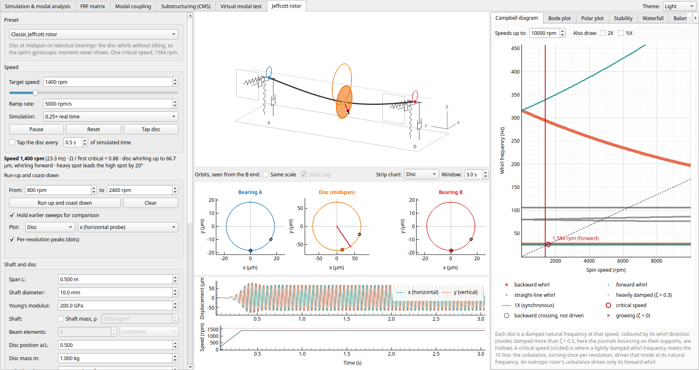

A ramp through a critical speed gives the whirl no time to build up to its steady-state peak.
The faster the ramp, the lower the peak, and the further past the critical speed it comes: after
it on a run-up, before it on a coast-down. Whether a ramp counts as slow depends on
Ω'/ω<sub>c</sub>² against ζ². Once past the critical, the free vibration left over at the natural
frequency beats with the 1X response.


A bent shaft drives the rotor with a force that does not grow with speed. Turning slowly, the
probes read the bow itself, so the polar curve starts from the bow, not from the origin. Here
the bow points opposite the heavy spot: its response falls as the unbalance's grows, and they
cancel at one speed. That is why the slow-roll vector is subtracted before balancing.


Balancing a bowed rotor shows why the slow roll is subtracted first. Relative to its bent shape,
a bowed shaft sees an unbalance m·δ<sub>b</sub>, so one weight removes every force the bow makes,
at every speed. What remains is the runout itself, which no weight removes and which makes no
force.


A skewed disc is a couple unbalance, which one weight can't cancel. Two weights on the disc's
faces make a force and a couple, the same form as the unbalance and the skew, so they cancel both
at every speed. Planes on the shaft would cancel the readings only at the balancing speed, and
planes close together need large weights, which errors in the readings swing.

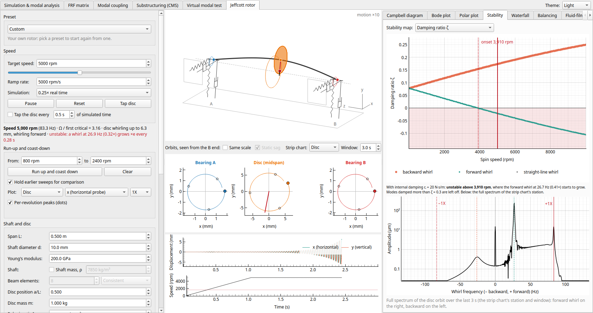

Damping inside the shaft (c<sub>i</sub>) or cross-coupled stiffness in the bearings
(k<sub>xy</sub>) pushes a forward whirl along its orbit. Past the onset speed the whirl grows by
itself at the rotor's natural frequency, not at the speed, and no balancing removes it. With
c<sub>i</sub> = 20 N·s/m the default rotor is stable up to 3910 rpm; with no damping in the
supports the onset falls to the first critical speed itself.


An overhung disc tilts as much as it moves, so the gyroscopic moment acts on the first mode
itself: the forward whirl stiffens with speed and the backward one softens. The *Overhung rotor*
preset's first mode, 870 rpm at rest, becomes critical at 1284 rpm, 48% higher than without the
gyroscopic moment; only that forward crossing is driven by the unbalance. The *Oil swirl
λ = ½* preset turns the cross-coupling up with speed instead: the rotor goes
unstable at 3136 rpm, twice its first natural frequency, and above that whirls at that
frequency whatever the speed (oil whip). The *Journal bearings* preset gets the same from the
bearings themselves: plain journal bearings, far stiffer than the shaft, put the critical at
1845 rpm, close to the rigid-bearing 1854 rpm, and their film's cross-coupling drives oil whip from
3576 rpm, a little below twice that, at 30.5 Hz.


Stood upright, the same rotor's bearings carry no load, so it whirls at any speed. With the films'
whole force, below twice its first natural frequency the whirl is oil whirl, at half the speed: the
film stiffens toward the wall and holds the journals circling close to it, a limit cycle. Past about
3700 rpm the whirl locks at the natural frequency instead, oil whip, and grows on.


On magnetic bearings the stiffness and damping come from a controller, and they change with the
frequency. In the *Magnetic bearings* preset the amplifier's lag turns the damping negative above
739 Hz. The disc's forward tilting mode rises with the speed, and at 8894 rpm it crosses into that band
and goes unstable, exactly where the bearings' damping changes sign.


A rotor that reaches its seals rubs them. The *Partial rub* preset sags into the bottom of its seal
ring and, past about 4000 rpm, hits it every other turn: the orbit closes every two revolutions and
the spectrum shows ½X, the sub-harmonic that flags a rub. The *Full rub* preset's tighter ring holds
the disc all round, and its friction, pulling the rim backward, flips the whirl at 1545 rpm into
backward whirl at 227 Hz, the disc's frequency on the ring, rolling round it on an orbit of 7.3 mm.


The rub's heat bows the shaft toward where it rubs. Below the critical speed that pushes the high
spot further into the rub, and the *Newkirk effect* preset's 1X vector spirals out, turning against
the spin; above the critical the bow pulls the high spot away, and the same rub heals.


A cascade plot stacks the spectra taken through a run-up at their speeds. The unbalance makes a
ridge along 1X; a tap rings the free whirl frequencies, which move only as the gyroscopic effect
moves them. Tapped all the way up, the overhung rotor draws its own Campbell diagram: the
backward whirl falls and the forward one rises, and the 1X ridge grows where it crosses the
forward branch. On a full spectrum the backward branch lies on the other side of zero, so 1X
never meets it, which is why the backward crossing is not a critical speed.


Jeffcott's shaft has no mass, which is fine while it is light beside the disc: the default
rotor's steel shaft (0.31 kg under a 1 kg disc) only takes the critical speed from 1584 to 1458
rpm, about what adding 17/35 of its mass to the disc predicts. But a shaft also has bending modes of its own. In the
*Long shaft* preset it weighs more than the disc, and the massless model puts the first critical
35% too high (2146 rpm, not 1589) and misses the second, at 6582 rpm, altogether. With consistent
mass the second critical comes down from above as elements are added (7393, 6591 and 6582 rpm
with 2, 4 and 8); lumped mass has no such bound (8187, 6733 and 6620).


A two-pole generator's rotor is stiffer bending one way than the other, so its stiffness turns
with it. Laid horizontal, its own weight acts on a stiffness that changes twice per revolution
and drives a 2X whirl, largest where 2Ω meets the natural frequency: the *gravity critical*, at
half the critical speed. The *Two-pole rotor* preset's disc whirls 447 µm at 2X at 785 rpm,
more than its mean sag. Balancing does nothing to it.


Between its two critical speeds, one per axis, the asymmetric shaft is unstable: turning with the
shaft, the centrifugal force beats the soft axis's stiffness but not the stiff one's, and a whirl
grows locked to 1X. Undamped, the band runs exactly between the two critical speeds (a test
checks); damping narrows it, and below Δ = 0.123 on the default supports there is none. Above
it the rotor is stable again, unlike the instabilities from cross-coupling and internal damping.


A crack in a horizontal shaft breathes: the weight opens it as its mouth turns down and shuts it
half a turn later. Its stiffness then changes once a turn, with 2X and 3X in it, so the weight
drives a 2X whirl near half the critical speed, as the asymmetric shaft's does, and a 3X near a
third of it, which the asymmetric shaft has none of. The *Cracked shaft* preset's disc whirls
37.6 µm at 2X at 783 rpm and 18.6 µm at 3X at 522 rpm, and its 1X at the critical is 164 µm
against 54 µm uncracked. Held open, the crack is an asymmetric shaft: no 3X, and twice the 2X.

### Duffing & Mathieu

The **Duffing & Mathieu** page drives one mass on a spring with a cubic term,
m x″ + c x′ + k(1 + μ cos φ) x + k<sub>3</sub> x³ = F cos φ, that hardens (k<sub>3</sub> > 0) or
softens (k<sub>3</sub> < 0) as it stretches, and sweeps the drive's frequency slowly up and down.
The pump μ makes the stiffness itself pulse at that frequency (parametric excitation, the Mathieu
equation), and a small random force gives an unstable rest something to grow from.

- **Harmonic balance**: the first harmonic's steady amplitude against frequency, solid where
  stable and dashed where not, with the backbone (the free oscillation's frequency at each
  amplitude) and the linear spring's curve for comparison. Between the two folds there are three
  amplitudes, the middle one unstable, and the arrows mark the jumps from each fold.
- **Sweeps**: each drive cycle's measured first harmonic, coloured by the sweep's direction, on
  top of the curve, with the measured jump frequencies beside the folds'. Hold the frequency
  inside the band and *Start on a branch* puts the mass on the lower, middle or upper steady
  state.
- **Parametric resonance**: pumped, harmonic balance's half-harmonic response (rest, unstable
  inside the tongue, and a cubic spring's swinging branches, in closed form), with each cycle's
  measured ½X amplitude (both harmonics are taken over pairs of cycles, so a swing at Ω/2 doesn't
  leak into the first).
- **Ince–Strutt chart**: the pumped linear spring's growth rate against the pump's frequency and
  depth at the page's damping, from the Floquet multipliers of every cell at once; the tongues
  reach down to Ω = 2ω<sub>n</sub>/n, with harmonic balance's first tongue dashed over them.
  Click to pump there.
- **Phase plane**: the last few cycles' trajectory and, while the frequency is held, the
  Poincaré section (the state once per drive cycle).
- **Presets**: hardening and softening jumps, a linear spring for comparison, two stable states
  at one frequency, a softening spring thrown over its potential's hilltop (the page pauses when
  it escapes), parametric resonance on a linear spring (it grows until the page pauses) and on a
  hardening one (it settles), a parametric sweep with its jump, and Ueda's chaotic oscillator.
- **Notes**: harmonic balance, the backbone, the jump and its stability, sweep rate and
  critical slowing down, superharmonics, subharmonics and chaos, parametric excitation,
  Floquet theory and the Ince–Strutt chart.


A hardening spring's resonance leans toward higher frequencies, because a bigger swing is a
stiffer one. Sweeping up, the mass rides the upper branch past the linear resonance (3.18 Hz) to
its fold at 4.45 Hz, then drops to the lower branch. Sweeping down, it follows the lower branch to
the other fold, at 3.64 Hz, and jumps up. Near a fold the steady state is barely stable, so a
sweep overruns it before the mass leaves: here it drops at 4.62 Hz and jumps up at 3.56 Hz.


Pump the spring's stiffness instead of pushing the mass and rest itself turns unstable near twice
the natural frequency: the mass swings at half the pump's frequency. On a linear spring the swing
grows for ever (as e<sup>0.05ω<sub>n</sub>t</sup> with μ = 0.3 and ζ = 2.5 %, which the
simulation and the Floquet multipliers agree on), and damping needs a pump deeper than 4ζ to
start it. A hardening spring's swing detunes itself out of the tongue and settles, which makes a
jump of its own: sweeping down from rest, nothing happens until rest turns unstable at the
tongue's upper edge, and then the swing leaps up to a branch that the sweep back up rides far past
the tongue.

### Torsional vibration

The **Torsional vibration** page takes a drive train apart: a line of discs (a motor, couplings,
gears, a fan, an engine's cranks, a generator) on shafts, each disc twisting against the next. Gear
meshes keep both gears' inertias and join them by the teeth's stiffness along the line of action, so
the far shaft turns at z<sub>in</sub>/z<sub>out</sub> times the near one's speed.

- **The train**: pick a disc or a link (or click it in the *Drive train* drawing) to change its
  inertia, stiffness or damping; make a shaft a gear mesh (teeth, base radius, mesh stiffness,
  transmission error) or a mesh a shaft; add and remove discs.
- **The interference diagram**: the natural frequencies, flat since nothing depends on the speed,
  against the orders that excite them: the train's own pulsating torque (an engine's firing
  orders, a compressor's, a misaligned coupling's 2×), each mesh's tooth-pass, and 1× and 2× of
  each shaft's speed. Where an order crosses a mode is a torsional critical speed; those within
  ±10 % of the running speed are filled red. Log scales show a mesh's kilohertz mode with the
  couplings'.
- **The steady response**: the dynamic torque in any shaft or mesh against the motor's speed,
  each order on its own and their sum, from (K − ω²M + iωC) Θ = T at each speed.
- **Mode shapes**: each mode's swing referred to the motor's shaft and which link it twists, and
  the n² reflection checked: the train referred to one shaft (inertias and stiffnesses × s²) has
  the same frequencies, while making the gears rigid keeps the lower modes and loses the mesh's.
- **The start-up** (centre, *Start-up* tab): a motor on the first disc runs the train up from rest
  against a load on the last that rises as its speed squared. An induction motor follows its
  speed–torque curve (Kloss's), with the line-frequency torque of switching it on direct on line;
  a synchronous motor starts on its cage, its poles adding a torque at twice the slip frequency
  that sweeps down from twice the line frequency through the modes below (drawn on the
  interference diagram too), and its field pulls it into step. The plots show a link's torque and
  the motor's speed as it plays, and each link's peak against what it carries running. Each step
  is the exact FOH update with the motor's and the load's torques solved at its end by Newton.
- **Presets**: a motor and fan on a coupling (two inertias, against the closed form), a geared
  compressor whose tooth-pass meets its mesh mode near the running speed, and a diesel generator
  set's firing orders against its crankshaft and flexible coupling. The fan starts on an induction
  motor and the compressor on a synchronous one.

![Torsional vibration page, the Geared compressor preset: a 10 kg·m² motor drives a 4:1 speed-up gearbox and a compressor through two couplings. On the log-log interference diagram the modes at 38.9 and 83.1 Hz (the couplings) and 2688 Hz (the mesh) cross the orders; the tooth-pass (120× the motor's speed) meets the mesh mode at 1344 rpm, 9.8 % below the 1490 rpm running speed, inside the ±10 % band; the dashed red curve is the synchronous motor's start-up pulsation, at twice the slip frequency, falling through the two coupling modes](docs/images/torsional_compressor.png)

The geared compressor's couplings make two modes, at 38.9 and 83.1 Hz, and the teeth a third, the
two gears bouncing on the mesh at 2688 Hz. Made rigid, the n² reflection keeps the first two to
within 0.1 % but loses that one, and it is the one the tooth-pass meets at 1344 rpm, inside the
band round the 1490 rpm running speed.


Started on a synchronous motor, the same compressor's poles pulse at 100 Hz at rest, falling as it
runs up: they pass the 83.1 Hz mode at 254 rpm and the 38.9 Hz one at 916 rpm. The second rings the
low-speed coupling up to 11.3 kN·m, 4.5× what it carries running, before the field pulls the motor
into step at 1500 rpm.

### Continuous systems

The **Continuous systems** page goes the other way from the chain: a string, a bar or a beam is a
continuum with infinitely many modes, and the chain is what you get by cutting it into N equal
elements. Its waves say which of the chain's modes to trust.

- **The medium**: a string (tension, mass per length), a bar (axial waves) or an Euler–Bernoulli
  beam (bending), its length, material and section, and each end fixed or free (a beam's clamped,
  pinned or free). The exact modes come in closed form, a beam's from its ends' frequency equation.
- **The mesh**: 1 to 200 elements, linear for the string and bar and Hermite cubics for the beam,
  with three ways to share out the mass, shown together: *lumped* (half to each node: beads on a
  string, or the first page's chain), *consistent* (from the stiffness's own shape functions, an
  upper bound on every frequency) and *mixed* (their average).
- **Dispersion**: frequency against wavenumber, the continuum's (ω = cκ, or aκ² for a beam) with each
  mesh's, which bends away and stops at κ = π/h, two elements a wavelength. The mesh's modes are dots
  on it: a string's or bar's lie exactly on the mesh's curve, since its modes are the endless mesh's
  waves sampled at the nodes. A beam's consistent mass adds a second branch, the slopes against the
  deflections, drawn past π/h, where its extra modes land.
- **Errors**: each mode's frequency error against its number, and the chosen mode's against the
  number of elements on log scales, with the slope: N<sup>−2</sup> lumped or consistent, N<sup>−4</sup>
  mixed for a string or bar; N<sup>−2</sup> lumped and N<sup>−4</sup> consistent for a beam.
- **Mode shape and frequencies**: the chosen mode, exact and on each mesh (the nodes and the
  elements' own interpolation between them), and a table of every mode's frequency and error.
- **Waves** (centre, *Waves* tab): a pulse runs along the continuum and the mesh side by side,
  travelling right or released at rest. The continuum's is exact: a string's or bar's two
  d'Alembert waves carried along, scattered at the ends in closed form, or a beam's exact modes
  summed. The mesh is stepped by its exact matrix exponential. On it the pulse sheds ripples
  (behind it with lumped mass, ahead with consistent), since its short waves travel at the wrong
  speed and none shorter than two elements travels at all. The pulse comes back from a fixed end
  upside down and from a free end upright. A *dashpot* on the far end reflects
  (1 − r)/(1 + r) of the wave, r its damping over the impedance Z (√(Tμ) or ρcA): matched (r = 1)
  it absorbs the continuum's pulse, but not the mesh's short waves. A *step* in the string's mass or
  the bar's section reflects (Z₁ − Z₂)/(Z₁ + Z₂) of a wave and passes 2Z₁/(Z₁ + Z₂). The mesh's
  energy is shown as it goes.
- **Presets**: a guitar string as beads, a steel bar held at one end, a steel ruler over a desk's
  edge, a vibraphone bar (free–free), and a pinned beam whose modes lie on the mesh's curve; and
  four wave presets: a pulse on 40 beads, a matched end, a light string tied to a heavy one, and a
  bending pulse on a beam.

![Continuous systems page, the Guitar string preset: on the dispersion plot the continuum's straight line ω = cκ (c = 106.8 m/s) and three 12-element meshes' curves bending away from it to the cut-off at κ = π/h = 58.2 rad/m, lumped low (topping out at 630 Hz where the continuum is at 989 Hz), consistent high (1090 Hz) and mixed close to the line, each mesh's modes dots on its curve; mode 6, four elements a wavelength, is marked: exact 494.4 Hz, lumped 445.2 Hz (−9.97 %), consistent 545.2 Hz (+10.3 %), mixed 487.6 Hz (−1.38 %). On the right its shape: each mesh's nodes are exactly on the sine](docs/images/continuum_string.png)

A low E string as 12 beads: the 6th harmonic, four beads a wavelength, is 10 % flat, though its
shape at the beads is the sine's exactly (MAC 1). The frequency error is all in the dispersion: the
beaded string is slower for short waves, and carries none shorter than two beads.

![Continuous systems page, the Steel ruler preset's Errors tab: the frequency error of each of 8 Hermite elements' modes against the mode number, lumped falling to −24 %, consistent within 1.2 % for the first six, mixed between them, and above mode 8 the consistent and mixed meshes' slope modes far off; below, mode 3's error against the number of elements on log scales, falling as N⁻² lumped and mixed and N⁻⁴ consistent; on the right mode 3's shape, the meshes' nodes on the exact one (MAC 0.992 lumped, 1.000 consistent)](docs/images/continuum_beam.png)

A clamped steel ruler's third mode: eight elements are already within 0.06 % with consistent
masses, which converge as N<sup>−4</sup>; lumped masses, leaving the slopes without inertia, only
as N<sup>−2</sup>.


Halfway along this string the mass per length is four times as much: twice the impedance and half the
speed. A third of the pulse comes back upside down and two thirds go on, squeezed to half the length.
On 100 elements the squeezed pulse is only five elements wide, and the mesh carries 0.49 of it where
the string carries 0.67, shedding ripples behind.

## The math, briefly

The *Background* tab in the app explains this in more depth; this is the outline.

**Model.** Newton's second law for each mass gives

$$M\ddot{x} + C\dot{x} + Kx = f(t)$$

where $M$ is diagonal (the masses) and $C$, $K$ are tridiagonal, assembled element by
element: each spring or damper between two neighbours adds $\begin{bmatrix}v & -v\\ -v & v\end{bmatrix}$
to their rows and columns (element 1 connects to ground). Everything is SI.

**Classical modal analysis.** Ignoring damping, $x = \phi\cos\omega t$ gives the symmetric
generalized eigenproblem $K\phi = \omega^2 M\phi$, which has N real natural frequencies
$\omega_r$ and real mode shapes $\phi_r$. With mass-normalized shapes collected in $\Phi$,
$\Phi^T M\Phi = I$ and $\Phi^T K\Phi = \mathrm{diag}(\omega_r^2)$. Damping is estimated
from the diagonal of $\Phi^T C\Phi$:

$$\zeta_r = \frac{\phi_r^T C\,\phi_r}{2\omega_r}$$

This is exact only if $\Phi^T C\Phi$ is diagonal (*proportional* damping, e.g.
$C = \alpha M + \beta K$). The app reports a coupling index, the largest off-diagonal term
relative to the diagonal, to show how far from proportional the damping is.

**State-space (complex) modal analysis.** With $z = [x,\ \dot{x}]$ the N second-order
equations become 2N first-order ones:

$$\dot{z} = Az + Bf, \qquad A = \begin{bmatrix} 0 & I \\ -M^{-1}K & -M^{-1}C \end{bmatrix}$$

The eigenproblem $A\psi = \lambda\psi$ is exact for any damping. It has 2N eigenvalues,
$\lambda = -\zeta\omega_n \pm i\omega_d$ in conjugate pairs, and eigenvectors of the form
$[\psi_x,\ \lambda\psi_x]$. One pair together gives a real motion
$x(t) = 2\,\mathrm{Re}(\psi_x e^{\lambda t})$. With non-proportional damping $\psi_x$ is
complex, so each mass has its own phase. The two methods are linked by matching each
damped pair to the undamped mode it most resembles (the modal assurance criterion, MAC).

**Modal coordinates.** Each method gives a change of coordinates that the time histories
can plot. Classical: $x = \Phi q$, so $q = \Phi^T M x$, and the equations become

$$\ddot{q} + \Phi^T C\Phi\,\dot{q} + \mathrm{diag}(\omega_r^2)\,q = \Phi^T f$$

which separate into N single-DOF equations only if $\Phi^T C\Phi$ is diagonal. Otherwise
damping transfers motion between the $q_r$. State-space: $z = V\eta$, so $\eta = V^{-1}z$,
and $\dot{\eta} = \Lambda\eta + V^{-1}Bf$ is decoupled for any damping. A conjugate pair
contributes $2\,\mathrm{Re}(\psi_x\eta_r)$ to $x$. The app scales each coordinate to the
mode's displacement at the mass where its normalized shape is 1: $\phi_{r,\max}\,q_r$
and $2\,\mathrm{Re}(\eta_r)$.

**Ground motion.** When the wall moves as $x_g(t)$, element 1 stretches by $x_1 - x_g$,
so the ground enters as a force on mass 1:

$$M\ddot{x} + C\dot{x} + Kx = (k_1x_g + c_1\dot{x}_g)\,e_1, \qquad
\frac{X}{X_g} = H(\omega)\,e_1\,(k_1 + i\omega c_1)$$

The simulator steps this exactly for a piecewise-linear $x_g$ by adding $x_g$ and its
slope to the state of the matrix exponential, as for the energy integrals below.

**Frequency response.** The receptance is solved directly at each frequency:
$H(\omega) = (K - \omega^2 M + i\omega C)^{-1}$. It is also a sum of modal terms. With the
state-space eigenvectors $V$ (and $V^{-1}$), every eigenvalue contributes a residue matrix,

$$H(\omega) = \sum_{r=1}^{2N} \frac{R_r}{i\omega - \lambda_r}, \qquad R_r = (V)_{x,r}\,(V^{-1})_{r,\dot{x}}\,M^{-1}$$

which is exact for any damping. For proportional damping it reduces to the classical
$H = \sum_r \phi_r\phi_r^T / (\omega_r^2 - \omega^2 + 2i\zeta_r\omega_r\omega)$.

**Energy.** Multiplying the equations of motion by $\dot{x}^T$ gives the power balance

$$\frac{d}{dt}\Big(\tfrac12\dot{x}^TM\dot{x} + \tfrac12 x^TKx\Big) = f^T\dot{x} - \dot{x}^TC\dot{x}$$

so the energy given plus the work done by the force equals the energy stored plus the
energy dissipated. With $q = \Phi^T Mx$ the stored energy is
$\sum_r \tfrac12(\dot{q}_r^2 + \omega_r^2 q_r^2)$ for any damping. The off-diagonal terms of
$\Phi^T C\Phi$ move energy between these terms.

**Time simulation.** The simulator advances $\dot{z} = Az + Bf$ with the exact
discrete-time solution. Over a step $h$, with the force varying linearly across the step
(first-order hold),

$$z_{k+1} = e^{Ah}z_k + \Gamma_0 f_k + \Gamma_1 f_{k+1}$$

where $e^{Ah}$, $\Gamma_0$ and $\Gamma_1$ come from a single matrix exponential of an augmented
matrix. The free response is exact, so the scheme is unconditionally stable and adds no
numerical damping, however stiff the springs are made: any decay you see is physical. The
step size adapts to the fastest mode, the drive frequency and the pulse length.

The work and dissipation over a step are integrals of quadratic forms in the state and
force. Adding the force and its slope to the state makes the step a linear system
$\dot{w} = A_w w$. Van Loan's matrix exponential then gives each integral exactly as
$w_k^T W w_k$, so the energy balance closes to rounding error.

**Friction.** Coulomb friction makes the chain nonlinear, but only piecewise: while each
mass keeps sliding the same way or stays stuck, friction is a constant force on each
sliding mass, and a stuck mass's row of $A$ is zeroed. Adding the friction forces to the
state again gives a linear system, stepped exactly. Within each step the simulator finds
the first moment a sliding mass stops or a stuck one breaks free (the pull of its
springs, dampers and the force exceeds the static friction $F_s \ge F_f$), on a cubic
through the step's ends, steps exactly to it and updates which masses stick. A mass that
stops sticks if the pull on it is at most $F_s$ and slides back otherwise. Over each piece friction takes out exactly
$F_f$ times the distance slid, so the energy balance still closes.

## Code layout

- `core/model.py`: assembles $M$, $C$, $K$ and the state-space matrices, and the force in each element.
- `core/modal.py`: classical modes (`scipy.linalg.eigh`), all 2N state-space eigenpairs
  (`scipy.linalg.eig`), the MAC pairing, the modal-coordinate map, and the frequency response.
- `core/frf_matrix.py`: the full receptance matrix and its modal (pole–residue) terms.
- `core/describing.py`: the describing-function (harmonic balance) response with Coulomb
  friction: each friction force's first harmonic, solved per frequency for the sliding and
  stuck masses.
- `core/simulator.py`: the exact first-order-hold time stepper (piecewise, with stick-slip friction) and its exact energy ledger.
- `core/presets.py`: the preset chains, vibration absorbers and Den Hartog's tuning.
- `core/energy.py`: kinetic, potential and stored energy, and the energy in each mode.
- `core/measurement.py`: the virtual modal test: excitation signals, a fast exact response
  (the FOH update diagonalized into one first-order filter per eigenvalue, or the simulator's
  stick-slip stepping with friction), anti-alias
  filtering and sampling, noise, windows, and the H1/H2 and coherence estimates.
- `core/oma.py`: operational modal analysis: the ambient record (random forces at every mass,
  the exact response, anti-alias filter and sensor noise), the cross-spectral matrix, frequency
  domain decomposition and enhanced FDD's bell and autocorrelation fit, covariance-driven
  stochastic subspace identification, the harmonic test (filtered kurtosis), and a hammer test
  through the virtual modal test's chain for comparison.
- `core/random_vibration.py`: random vibration: band-limited force or base-acceleration PSDs,
  the response's PSD H G Hᴴ and cumulative RMS, Miles' equation mode by mode, a record synthesized
  to the PSD and stepped by the exact FOH update, and Welch's estimate.
- `core/complex_modes.py`: non-proportional damping: the complex modes' MPC and MPD, the
  proportional approximation's damping, poles and FRF against the exact ones, the free decay
  from an undamped mode's shape, a damper's or spring's root locus, and LSFD with real and with
  complex modes.
- `core/identification.py`: modal parameter extraction from a measured FRF column: peak
  picking, circle fit, LSCF with its stabilization diagram, LSFD, and matching to the exact
  modes (MAC).
- `core/substructure.py`: component mode synthesis (Craig–Bampton, Rubin, MacNeal), mode
  comparison (frequency error, MAC) and the reduced-model FRF.
- `core/modal_coupling.py`: two subsystems reduced to one oscillator each and joined as a 2-DOF
  model (effective, residual and tip modal masses), its comparison with the chain, the
  drive-point FRFs, and the frequency and mass-ratio sweeps.
- `core/cms_response.py`: the full chain and a reduced model stepped side by side under the
  same force (MacNeal's massless boundary condensed statically).
- `core/back_expansion.py`: recovery of the interior DOFs from the coupled solution (by T,
  from the boundary alone, and by re-solving each interior with the boundary motion imposed,
  stepped in the same exact update) and of the spring forces.
- `core/rotor.py`: the Jeffcott rotor: shaft (beam elements: massless and condensed to the
  stations, or with mass and reduced to the stations and its fixed-interface modes), disc,
  bearings and the gyroscopic matrix; whirl modes, the Campbell diagram and critical speeds, the steady 1X
  response to the unbalance, the disc's skew and the shaft's bow, and an exact FOH time
  stepper that follows a speed ramp. An asymmetric shaft's turning stiffness: its Floquet modes
  (in axes turning with the shaft, or by Hill's method), its steady states by harmonic balance
  (`harmonic_response`, `gravity_response`), and a split time step with the turning stiffness as
  a mid-step kick. A cracked shaft (`Crack`): a hinge at the crack, breathing open under the
  weight, its 1X–3X steady state (`steady_harmonics`). Oil films linearized about each
  journal's equilibrium, or stepped with their whole force (`nonlinear_films`), and magnetic
  bearings with their controllers' states in the state vector.
- `core/fluid_bearing.py`: the plain journal bearing by short-bearing (Ocvirk) theory: its
  equilibrium, the eight stiffness and damping coefficients in closed form, and the film's whole
  force, in closed form (`force`) and by quadrature (`film_force`) to check it.
- `core/magnetic_bearing.py`: the active magnetic bearing: the magnets' negative stiffness and
  current gain, the PID with a filtered derivative behind a first-order amplifier, its transfer
  function (`gain`) and its state space.
- `core/rotor_sweep.py`: run-up and coast-down: the steady-state 1X (and gravity's 2X) vectors at each station,
  once-per-revolution tracking of the 1X and 2X vectors and peak (`RevolutionTracker`), and
  `RunUpCoastDown`, which drives the stepper through a sweep and records each leg.
- `core/rotor_balance.py`: single- and two-plane balancing: influence coefficient and matrix,
  correction weights, and `SteadyMeasurement`, which runs the stepper at a speed, lets it settle and averages the
  1X vector over some revolutions.
- `core/rotor_analysis.py`: what the rotor page works out when its parameters change (the
  Campbell diagram, the stability onset, the steady states: `analyse`), and `AnalysisWorker`,
  which runs it in a process of its own so the animation keeps going meanwhile.
- `core/rotor_presets.py`: the rotor page's presets, each a `RotorSystem` with a speed range
  and a note.
- `core/rotor_stability.py`: the least damped mode, the onset speed of instability (swept,
  then bisected, with the end of the band if it ends), the log decrement, the full spectrum of
  an orbit, and `AsymmetryChart`, the growth rate against asymmetry and speed, filled in a few
  cells at a time.
- `core/rotor_waterfall.py`: `Waterfall`, full spectra of the orbits taken block by block as
  samples are fed in, each with the free whirl frequencies at its speed, and the latest run-up
  or coast-down among them.
- `core/duffing.py`: the Duffing oscillator: harmonic balance's response curve (traced by
  amplitude, unstable branch included) with its folds and backbone, the pumped spring's
  half-harmonic response and first tongue, the Floquet growth rate over the Ince–Strutt chart, the
  swept drive, an exact FOH stepper with the cubic's and the pump's forces found by Newton each
  step, each drive cycle's first and half harmonics, and the page's presets.
- `core/torsional.py`: torsional drive trains: discs, shafts and gear meshes (with transmission
  error), the modes and their twist, the train referred to one shaft and with rigid gears, the
  orders and torsional critical speeds, the steady forced response, and the page's presets.
- `core/torsional_startup.py`: a motor starting the train: the induction motor's curve and
  switch-on transient, the synchronous motor's 2× slip pulsation and field, a load rising as speed
  squared, the exact FOH stepper with the two torques found by Newton each step, the steady running
  torques, and the start-up presets.
- `core/continuum.py`: a string, a bar or an Euler–Bernoulli beam: the exact modes (the beam's from
  its ends' frequency equation), meshes of N elements with lumped, consistent or mixed mass, their
  dispersion (in closed form, or a node's Bloch wave), each mode's error and its convergence with
  N, and the page's presets.
- `core/continuum_waves.py`: a pulse on the continuum (a digital waveguide carrying d'Alembert's
  waves, with the ends, a dashpot and a step scattering them in closed form, or a beam's exact
  modes) and on the mesh (stepped by its exact matrix exponential), and the wave presets.
- `gui/`: the PySide6 and pyqtgraph interface. It runs on a ~60 fps timer that advances
  the simulator by wall-clock time × speed. `gui/style.py` holds the colour themes; every
  widget reads its colours from the current one (`colors.mass[i]`, `colors.force`) and
  redraws in a new one through its `apply_theme()`. Log axes use `gui/axes.py`, which labels
  only as many ticks as fit.

To measure the frame rate on your own display, start the app with `VIB_FRAME_STATS=1`
(e.g. `VIB_FRAME_STATS=1 uv run vib-tutorial`): an overlay in the corner shows the running
page's frames per second, the time each frame spends computing and painting (median and 95th
percentile) against the display's refresh, the share of late frames, and the simulation's speed
against real time. `VIB_FRAME_STATS=frames.csv` also logs every frame to that file, with
what was on screen (page, sub-tab, rotor preset, window size, display scale and refresh rate)
and what you clicked, typed or picked in between. `uv run python scripts/frame_report.py
frames.csv` then summarizes it by view and input: frames per second, computing and drawing
time for each.

`scripts/readme_screenshots.py` regenerates the images in `docs/images` (offscreen, each in
the state its caption describes): `uv run python scripts/readme_screenshots.py`, or name the
shots to retake, e.g. `... chirp pluck`.

The `core` package has no Qt dependency, so you can use it from scripts or notebooks:

```python
from vib_tutorial.core import ChainSystem, modal_analysis

chain = ChainSystem([1.0] * 4, [400.0] * 4, [15.0, 2.0, 2.0, 2.0])
res = modal_analysis(chain)
[(m.fn_hz, m.zeta_modal, m.damped.zeta) for m in res.modes]    # classical, N modes
[(m.eigenvalue, m.shape) for m in res.complex_modes]           # state-space, 2N modes

import numpy as np
from vib_tutorial.core import Simulator, modal_coordinate_map

sim = Simulator(chain)
sim.set_displacement(0.01 * res.modes[2].shape)                # release classical mode 3
t, x, v, f = sim.advance(2.0)                                  # per-step samples
z = np.hstack([x, v])
q = z @ modal_coordinate_map(chain, res)                       # classical, (steps, N), m
eta = z @ modal_coordinate_map(chain, res, complex_modes=True) # one per pair, m

from vib_tutorial.core import modal_energies

E = modal_energies(chain, res, x, v)                           # (steps, N), J; rows sum to T + V
sim.energy_added + sim.work - sim.dissipated - sim.stored_energy  # ~1e-15 J: exact balance
added, work, dissipated, friction = sim.ledger.T                # the same ledger at each step of the last advance

from vib_tutorial.core import ForceController, ForceKind, ForceSettings, element_forces, pluck_shape, transmissibility

spring, damper = element_forces(chain, x, v)                   # (steps, N) tension, N
sim.set_displacement(pluck_shape(chain, 1, 0.02))              # hold m2 at 20 mm, then let go

shake = ForceController(ForceSettings(kind=ForceKind.CHIRP, sweep_start_hz=0.5, sweep_end_hz=8.0,
                                      base=True, base_amplitude=0.005))  # 5 mm ground sweep
sim = Simulator(chain, shake)
shake.switch_on()
t, x, v, xg = sim.advance(2.0)                                 # xg: the ground motion, m
transmissibility(chain, np.array([0.5, 2.0]))                  # X / X_g, (freqs, N)

from vib_tutorial.core.presets import den_hartog, tuned_mass_damper, with_absorber

tmd = tuned_mass_damper(ChainSystem.uniform(4), mu=0.05)       # 5-mass chain, damper on m4 tuned to mode 1
den_hartog(0.05)                                               # (f_a / f_1, zeta_a on f_1) = (0.952, 0.127)

from vib_tutorial.core import compare_modes, craig_bampton

s = ChainSystem.uniform(8)
cb = craig_bampton(s, interfaces=[3], n_kept=[1, 1])          # cut at m4, 1 mode each
[(c.fn_true, c.fn_red, c.mac) for c in compare_modes(cb, modal_analysis(s))]

from vib_tutorial.core import compare_coupled, coupled_model
from vib_tutorial.core.modal_coupling import coupled_frf, sweep

pair = coupled_model(chain, split=2)                           # A = m1-m2, B = m3-m4, mode 1 of each
[(c.fn, c.fn_full, c.error) for c in compare_coupled(pair, res)]  # 2-DOF vs chain
coupled_frf(pair, np.array([1.0, 2.0]), "free")               # x4 / F4 of the 2-DOF model
sweep(pair, "mass").two_dof                                    # (points, 2) Hz as mu is swept

from vib_tutorial.core import free_interface
from vib_tutorial.core.cms_response import CMSResponse

rubin = free_interface(s, interfaces=[3], n_kept=[1, 1])       # B keeps its rigid-body mode
macneal = free_interface(s, [3], [1, 1], residual_mass=False)  # massless residual: 2 modes

step = ForceController(ForceSettings(kind=ForceKind.STEP, amplitude=10.0))
both = CMSResponse(cb, step)                                   # full and reduced, same force at the tip
step.switch_on()
t, x_full, x_cb, f = both.advance(2.0)                         # (steps, N) each; x_cb = T r

from vib_tutorial.core import (Acquisition, Excitation, FrfEstimator, MeasurementSettings,
                               Processing, Window)

acq = Acquisition(chain, MeasurementSettings(excitation=Excitation.RANDOM, input_dof=3,
                                             fs=20.0, block=1024, averages=20, overlap=0.5))
while not acq.done:
    acq.step()                                                 # one block per step
est = FrfEstimator(acq, Processing(window=Window.HANN, response_noise=0.02)).estimate()
est.freqs, est.H, est.coherence                                # (F,), (F, N), (F, N)

from vib_tutorial.core.identification import auto_select, lscf, lsfd, match_modes

band = (0.0, acq.settings.band)
stab = lscf(est.freqs, est.H, band, max_order=30)              # poles at every order
ident = lsfd(est.freqs, est.H, band, [stab.pole(o, i) for o, i in auto_select(stab)])
[(r.mode, r.identified and r.identified.fn_hz, r.mac) for r in match_modes(ident.modes, res, 8.0)]

from vib_tutorial.core.rotor import RPM, STEEL, Bearing, RotorSimulator, RotorSystem, campbell, synchronous_response

rotor = RotorSystem(position=0.3, bearing_a=Bearing(kx=2e4, ky=8e4))   # disc off centre, A anisotropic
M, C, G, K = rotor.matrices()                                  # 8x8; M q'' + (C + ΩG) q' + (K + ΩH) q = f
[(w * RPM, whirl) for w, whirl, zeta in campbell(rotor, 1000.0).criticals]  # rpm, +1 forward
Q = synchronous_response(rotor, np.array([150.0]))             # steady whirl at 150 rad/s, complex (1, 8)
bent = rotor.with_(bow=10e-6, bow_angle=np.pi, skew=np.radians(0.1))  # bow against the heavy spot, disc skewed
weighted = rotor.with_(weights=(2e-5 * np.exp(1j * np.pi),))  # a 20 g·mm balance weight at 180° from the mark
rotor.with_(gravity=9.81).static_deflection()                  # sag under its own weight, (8,)
heavy = rotor.with_(density=STEEL, elements=8)                 # the shaft's own mass: beam elements
heavy.n_dof, heavy.fixed_interface_freqs                       # (12, ...): q = 8 stations + 2 shaft modes per plane
spin = RotorSimulator(rotor)
spin.target = 3000 / RPM                                       # ramps at spin.accel (rad/s²)
r = spin.advance(0.25)                                         # r.t, r.q (steps, 8), r.omega, r.phase

from vib_tutorial.core.rotor_sweep import RunUpCoastDown, probe, steady_vectors

V = steady_vectors(rotor, np.linspace(10.0, 300.0, 500))       # 1X vectors (500, 4 stations, x/y), complex
spin.accel = 1000 / RPM                                        # 1000 rpm/s
up, down = RunUpCoastDown(spin, 800 / RPM, 2400 / RPM).run()   # each leg tracked once per revolution
w, v, peak = up.trace(1, "x")                                  # disc, x probe: speed, 1X vector, max |x|
up.peak(1, "orbit")                                            # (largest 1X major axis, speed it came at)

from vib_tutorial.core.rotor import gravity_response
from vib_tutorial.core.rotor_stability import full_spectrum, stability_onset

unstable = RotorSystem(internal_damping=20.0, bearing_a=Bearing(kxy=5e3))  # H = unstable.circulatory()
onset = stability_onset(unstable, 1000.0)                      # Onset(omega, freq_hz, whirl) or None
whip = RotorSystem(bearing_a=Bearing(swirl=0.5), bearing_b=Bearing(swirl=0.5))  # k_xy grows as cΩ/2
stability_onset(whip, 1000.0).order                            # 0.5: the whirl at half the speed at onset
overhung = RotorSystem(position=1.2)                           # the disc 0.2 L past bearing B
f, amp = full_spectrum(r.t, r.q[:, [1, 5]])                    # disc orbit: +f forward, −f backward
two_pole = RotorSystem(asymmetry=0.15, gravity=9.81)            # EI(1 ± 0.15), stiff axis at the mark
band = stability_onset(two_pole, 300.0)                        # unstable from band.omega to band.end (rad/s)
q0, q2 = gravity_response(two_pole, np.array([82.2]))           # mean sag, and the 2X whirl near half the critical

from vib_tutorial.core.fluid_bearing import JournalBearing

oil = Bearing(film=JournalBearing())                           # a plain journal bearing (short-bearing theory)
upright = RotorSystem(bearing_a=oil, bearing_b=oil, nonlinear_films=True)  # stepped with the films' whole force
JournalBearing().force(5e-6, -8e-6, 0.0, 1e-3, 300.0)          # the whole film's force (N) at any position, velocity

from vib_tutorial.core.magnetic_bearing import MagneticBearing
from vib_tutorial.core.rotor import Crack, steady_harmonics

floating = RotorSystem(bearing_a=Bearing(magnet=MagneticBearing()), bearing_b=Bearing(magnet=MagneticBearing()))
floating.n_states                                              # 2 n_dof + the controllers' states
MagneticBearing().dynamic_stiffness(2j * np.pi * 50.0)         # k_i G(s) - k_m at 50 Hz (N/m, complex)
cracked = RotorSystem(crack=Crack(position=0.5, depth=0.4), gravity=9.81, unbalance=5e-6)
q0, v = steady_harmonics(cracked, np.array([400 / RPM]))       # mean sag, and the 1X, 2X, 3X vectors

from vib_tutorial.core.rotor_waterfall import Waterfall

wf = Waterfall(0.5, 100.0, rotor)                              # 0.5 s blocks, |f| up to 100 Hz
wf.feed(r.t, r.q[:, 1] + 1j * r.q[:, 5], r.omega)              # z = x + iy, (k, stations); returns new blocks
[(b.omega * RPM, b.natural) for b in wf.latest_ramp(up=True)]  # each block's speed, free whirl lines (Hz)

from vib_tutorial.core.rotor_balance import SteadyMeasurement, correction, influence, weight

v0 = probe(SteadyMeasurement(spin, 1200 / RPM).run()[1], "x")  # disc, x probe: settled 1X reading
trial = weight(0.5e-3, 0.02, 0.0)                              # 0.5 g at 20 mm, at the mark (kg·m)
spin.set_system(rotor.with_(weights=(trial,)))
v1 = probe(SteadyMeasurement(spin, 1200 / RPM).run()[1], "x")
W = correction(v0, influence(v0, v1, trial))                   # the weight that cancels v0 (kg·m)

# Two planes on the disc's faces (PlaneWeight(z, w, disc=True)), probes at A and B (x).
from vib_tutorial.core.rotor import PlaneWeight
from vib_tutorial.core.rotor_balance import corrections, influence_matrix

skewed = rotor.with_(position=0.3, skew=np.radians(0.5))
planes = [PlaneWeight(skewed.a - 0.02, 0j, disc=True), PlaneWeight(skewed.a + 0.02, 0j, disc=True)]

def read(s):                                                   # steady 1X readings at the two bearings
    v = steady_vectors(s, np.array([1200 / RPM]))[0]
    return np.array([probe(v[0], "x"), probe(v[3], "x")])

v0 = read(skewed)
runs = [read(skewed.with_(plane_weights=(p._replace(weight=trial),))) for p in planes]
alpha = influence_matrix(v0, runs, [trial, trial])             # 2 x 2: a column per plane
W = corrections(v0, alpha)                                     # [7.32 g, 6.32 g] at 20 mm, 180° and 0°
balanced = skewed.with_(plane_weights=tuple(p._replace(weight=w) for p, w in zip(planes, W)))
```

## Ideas for extension

- Save and load parameter presets for classroom exercises

## Disclaimer and license

This software is provided for **educational purposes only**. It was written with an AI coding
assistant, [Claude Code](https://claude.com/claude-code), and although it has an automated test
suite, its results are **not guaranteed to be technically correct**: the simulations, modal
analysis, substructuring, identification and theory notes may contain errors. Validate any
calculation independently (by hand, with established references or with qualified software)
before relying on it, and do not use it for design, certification, safety-related or other
engineering decisions.

The software is provided **"as is", without warranty of any kind**, express or implied,
including the warranties of merchantability, fitness for a particular purpose and
non-infringement. In no event shall the authors or copyright holders be liable for any claim,
damages or other liability arising from the software or its use.

Released under the [MIT License](LICENSE). Copyright (c) 2026 WookieLumberjack.
